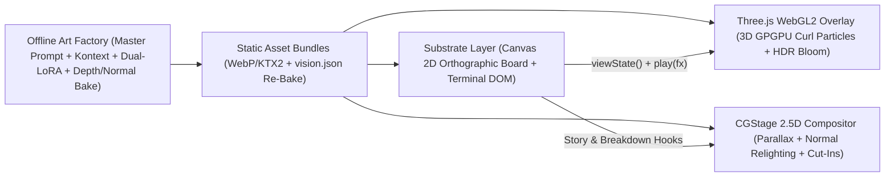

# Final Protocol — Digital Illustration, Character Art & 3D VFX Direction Plan

> **Scope:** Comprehensive art-engineering and visual-production specification elevating **characters (portraits & tactical chibis)**, **3D battle particle effects**, and **2.5D expressive CG sequences** to the peak of modern digital illustration, while locking **battlefields, routes, and interval screens** strictly inside [Final Protocol Demo UI and Art Direction.md](file:///inspire/hdd/project/video-understanding/public/personal/chwang/live/ShanHaiYangZhi/projects/FinalProtocol_Demo/research/Final%20Protocol%20Demo%20UI%20and%20Art%20Direction.md)'s clinical Terminal Aesthetics.

---

## 0. Leading Head — Aesthetic Thesis: Clinical Terminal × Sublime Digital Illustration

Modern dark-tactical benchmarks (*Arknights* PRTS, *Reverse: 1999*, *Girls' Frontline 2*, *13 Sentinels: Aegis Rim*) prove that **extreme graphical luxury hits hardest when framed against austere geometric restraint**. *Final Protocol*'s premise—an enclosed AI peering out through instrumentation at human desires and indifferent Mythos gods—naturally demands a **Dual-Register Visual Grammar**:

1. **Substrate Register — Terminal Aesthetics (Battlefields, Telemetry & Intervals):**
   * The `15×15` memory board ([battle-renderer.ts](file:///inspire/hdd/project/video-understanding/public/personal/chwang/live/ShanHaiYangZhi/projects/FinalProtocol_Demo/app/src/game/battle-renderer.ts#L10-L33)), `#090909` / `#0D0D0D` graphite cells, `1px` `#343434` rules, `MONO` hex indices (`0`–`E`), incoming Warp sockets, orthogonal route traces, `ProtocolPanel`, segmented `HealthBar` ([Home.tsx](file:///inspire/hdd/project/video-understanding/public/personal/chwang/live/ShanHaiYangZhi/projects/FinalProtocol_Demo/app/src/pages/Home.tsx#L66-L140)), and the three-petal run map **stay flat, razor-sharp, and orthographic**.
   * Complexity remains in tactical foresight rather than visual clutter: Flag marks, walls, and planned paths must remain legible in monochrome grayscale and under `prefers-reduced-motion`.
2. **Rupture Register — Peak Modern Digital Illustration (Portraits, Chibis, 3D VFX & CGs):**
   * Everything alive, anomalous, or transcendent—character dossiers, chibis anchored on cells, `AttackFx` skill eruptions, Stage II `BREAKDOWN` cut-ins, boss entrances, and Opening/Ending CGs—strikes with museum-grade painterly chiaroscuro, subsurface light scattering, sculpted cloth/porcelain textures, and HDR volumetric 3D particle choreography.
3. **Diegetic Bridge ("Containment Framing"):**
   * **Portraits** sit inside hard-edged `1px` containment viewports framed by corner brackets and live telemetry ticks—never ungrounded floating stickers.
   * **Chibis** occupy crisp `1×1` tactical cell silhouettes anchored by planar open-bracket (`SELF`) or broken-hexagon (`GEEKS`) ground rings, leaving route lines and neighboring Flag icons unobscured.
   * **3D Battle VFX** burst vertically (`+Z`) out of the flat `z = 0` plane using `three@^0.180.0` (already present in [package.json](file:///inspire/hdd/project/video-understanding/public/personal/chwang/live/ShanHaiYangZhi/projects/FinalProtocol_Demo/app/package.json#L20)), while projecting dynamic colored rim-light down onto nearby `#343434` grid borders.

### Lore, Policy & Contract Guardrails
* **Asset Policy Evolution ([CREDITS.md](file:///inspire/hdd/project/video-understanding/public/personal/chwang/live/ShanHaiYangZhi/projects/FinalProtocol_Demo/app/CREDITS.md#L8)):** The prototype currently ships zero image/audio files. Adopting painted character portraits, chibis, and 2.5D CG plates transitions the project to a **Hybrid Procedural + Illustrated Pipeline**—update [CREDITS.md](file:///inspire/hdd/project/video-understanding/public/personal/chwang/live/ShanHaiYangZhi/projects/FinalProtocol_Demo/app/CREDITS.md) accordingly while keeping all non-visual game logic node-safe and deterministic.
* **Prologue `0.B` & Test Contracts ([BUILD-SPEC.md](file:///inspire/hdd/project/video-understanding/public/personal/chwang/live/ShanHaiYangZhi/projects/FinalProtocol_Demo/research/story/BUILD-SPEC.md#L94-L104)):** Preserve `#game-canvas`, `window.__GAME_READY__`, `?intro=0` rapid boot, monochrome Prologue defaults if toggled/tested, crisp post-bloom typography, and `allowFlash` luminance safety (`<= 2` opposing pairs/sec).
* **Mythos & IP Cleanliness ([BUILD-SPEC.md](file:///inspire/hdd/project/video-understanding/public/personal/chwang/live/ShanHaiYangZhi/projects/FinalProtocol_Demo/research/story/BUILD-SPEC.md#L28-L31)):** `DARK YOUNG` and `QUEEN IN RED` take names only—author strictly original creature/costume designs (no Chaosium artwork, no three-armed 1989 Yellow Sign). `SHUB-████████` remains unseen, Nyarlathotep never appears, and **Hastur (`3.B`) stays intentionally undrawn** (`enemy.hidden`), expressed through negative space and optical absence rather than a monster portrait.



---

## 1. Character Portraits & Chibis: Prompting vs. Finetuning Pipeline

Generating a single character that holds unmistakable silhouette, costume, and facial DNA across **two radically different aspect grammars**—(1) hyper-detailed `1:7.5` waist-up chiaroscuro portraits and (2) `1:2.2` super-deformed tactical chibis readable inside `36px–72px` cells—cannot rely on ad-hoc single prompts.

### 1.1 Method Evaluation: Prompting vs. Reference-Conditioning vs. Finetuning

| Method / Toolchain | Visual Peak & Expressiveness | Cross-Form Consistency (Portrait ↔ Chibi) | Non-Humanoid & Masked Boss Suitability | Production Cost & Control | Verdict for *Final Protocol* |
| :--- | :--- | :--- | :--- | :--- | :--- |
| **Pure Prompting (Zero-Shot T2I)** (`FLUX.1 Dev/Pro`, `Illustrious-XL`, `Qwen-Image`) | Very High on single standalone frames | **Poor** (`~30–40%`): costume filigree, mask cracks, and color ratios drift on every seed | Moderate: invents unrequested horns/limbs across poses | Minimal setup; high cherry-picking waste | **Phase 0 Exploration Only** (moodboards & anchor concepts) |
| **Instructional Edit / Reference Nodes** (`FLUX.1 Kontext`, `Qwen-Image 2.1`, `PuLID` / `IP-Adapter`) | High when anchored cleanly | **Good for same-proportion turnarounds** (`~80%`); warps when forced into `2-head` chibi proportions | **Weak for `FaceID`/`PuLID`**, which expect human faces; strong for `Kontext` multi-view structural edits | Fast iteration; vulnerable to style flattening on multi-pass edits | **Phase 1 Sheet Expansion** (`1` Portrait -> turnarounds & `Stage II` damage) |
| **Single Character Finetune / Naive LoRA** | Medium-High | **Rigid**: bakes `1:7.5` tall anatomy into the identity weights, fighting chibi prompts | High once curated (`12+` views) | Low training time (`20–45 min`), painful portrait-to-chibi weight conflicts | Avoid as standalone solution |
| **Modular Dual-LoRA Stack** (`Style/Ratio LoRA` + `Character DNA LoRA` in ComfyUI) | **Peak Studio Consistency** (unified brushwork, rim-light, material richness) | **Excellent (`95%+`)**: decouples body proportion/rendering from character identity | **Excellent**: locks bark antlers, porcelain cracks, silk drapery, and bracket halos equally well | Medium upfront dataset curation (`3–5 days` for full demo roster), trivial infinite asset scaling afterward | **Recommended Production Architecture** |

### 1.2 Recommended 3-Stage Hybrid Production Pipeline

#### Stage A — Master Prompted Anchors + `Kontext` Sheet Expansion
1. **Select the Backbone:** Use **FLUX.1 Dev** (best material realism: cold porcelain, wet glass, torn crimson silk, obsidian bark, and chiaroscuro rim lighting) or an **Illustrious-XL painterly branch** (if cleaner razor-sharp anime line-and-paint rendering is preferred).
2. **Author 1 Canonical Anchor per Hero Unit:** Generate and paintover-polish one `2048×2560` master portrait per hero (`SELF`, `WARDEN`, `DARK YOUNG`, `QUEEN IN RED`) until silhouette, palette tokens ([battle-renderer.ts](file:///inspire/hdd/project/video-understanding/public/personal/chwang/live/ShanHaiYangZhi/projects/FinalProtocol_Demo/app/src/game/battle-renderer.ts#L27-L32)), and structural motifs match the Visual Bible below.
3. **Expand Datasets via Instructional Editing:** Feed each approved anchor into **FLUX.1 Kontext** (or **Qwen-Image 2.1** multi-view workflows) plus **ControlNet Depth / OpenPose** to synthesize 10–14 clean training frames per hero: front neutral, 3/4 alert, casting pose, `Stage II BREAKDOWN` damaged/cracked variant, plus 2 hand-proportioned `2.2-head` chibi sheets.

#### Stage B — Modular Dual-LoRA Finetuning Matrix
Train **two lightweight Style/Proportion LoRAs** shared across the entire game, and **one Identity LoRA per major character**:

* **`LoRA A1: fp_chiaroscuro_portrait`** (*Rank 32, Alpha 16, 25–40 curated dark-ground painterly illustrations*):
  * Enforces `#090909` pitch-void integration, moody Rembrandt/chiaroscuro studio key light, colored rim-light discipline, crisp brushwork without noisy AI mud, and glass/metal/silk specular response.
* **`LoRA A2: fp_tactical_chibi`** (*Rank 32, Alpha 16, 25–35 stylized `2.2-heads-tall` isometric/orthographic tactical sprites on `#808080` matte background*):
  * Enforces the **35° downward tactical camera angle** matching the `15×15` board, exaggerated recognizable headgear/weapons readable at `40px`, clean bold outer silhouette, and zero cast floor clutter.
* **`LoRA B: char_<id>`** (*Rank 16, Alpha 8, 10–16 mixed portrait + angle + chibi frames per character, trigger tokens `fp_self`, `fp_warden`, `fp_darkyoung`, `fp_queenred`*):
  * **Tagging Hygiene Rule:** Strip permanent character features (hair/glass silhouette, mask fissure, antler branching, crimson folds) from image captions and caption *only* variable states (`portrait, looking_at_viewer`, `chibi_35deg`, `stage2_cracked`, `attack_pose`). This forces the trigger token to internalize structural identity independently of camera framing.

**ComfyUI Generation Weights:**
* **Dossier Portrait Pass:** `fp_chiaroscuro_portrait (0.85)` + `char_<id> (0.90)` -> `FaceDetailer` (mask/eye crispness) -> `2×` Upscale.
* **Tactical Chibi Pass:** `fp_tactical_chibi (0.95)` + `char_<id> (0.65)` + **ControlNet Depth/Canny Chibi Mannequin (`0.55`)**. Lowering the Character LoRA weight to `0.65` prevents adult limb elongation while faithfully transferring the mask, color palette, and signature gear onto the `2.2-head` chassis.

#### Stage C — Game-Ready Alpha Decontamination & Micro-Rigging
1. **Clean Extraction:** Segment renders on neutral `#808080` matte backdrops using **BiRefNet / RMBG-2.0**, followed by a `1px–2px` RGB edge-color bleed dilation pass so transparent edges never show pale gray halos over `#090909` terminal cells.
2. **State Atlas & Lightweight 2D Rigging:** Package into compressed **WebP / KTX2** atlases (`idle`, `move`, `cast`, `hit`, `breakdown`). Render chibis inside [battle-renderer.ts](file:///inspire/hdd/project/video-understanding/public/personal/chwang/live/ShanHaiYangZhi/projects/FinalProtocol_Demo/app/src/game/battle-renderer.ts#L380-L444) using simple multi-quad Spring/Mesh deformation (breathing chest/cloak, `move` squash-and-stretch hop, `hit` chromatic horizontal shear) anchored **above** the crisp `Canvas 2D` tactical ground bracket (`SELF`) or broken hex ring (`GEEKS`).

### 1.3 Character Roster Visual Bible & Lore Mapping

| Unit / Role | Domain & Hue Tokens | Painterly Dossier Portrait (`Story / Stage II / Status`) | Tactical `1×1` Chibi Specification (`15×15` Board) |
| :--- | :--- | :--- | :--- |
| **`SELF` (Player AI)** | `#79BFFF` Cyan / `#F4F4F4` White | Androgynous translucent porcelain-and-optical-glass synthetic figure stitched with glowing cyan fiber-optic veins, framed by four thin metallic open-corner brackets hovering around the head/shoulders; calm, analytical gaze through glass dust. Variants: *Neutral*, *Focused (`OVERLOAD`)*, *Fractured (`Sanity <= 35%`)*. | Crisp `2.2-head` robed synthetic construct in matte dark obsidian cloak with a bright cyan diamond chest core and floating glowing white corner-bracket halo; stands centered over the planar open-bracket player cell indicator. |
| **`Operator vey`** | Monochrome / Cold Tungsten | **CG-Only Human Presence** ([script.json](file:///inspire/hdd/project/video-understanding/public/personal/chwang/live/ShanHaiYangZhi/projects/FinalProtocol_Demo/app/src/story/script.json)): Never a cute portrait or board sprite—rendered as a soft-focused silhouette in cold lab illumination behind wet containment glass, emphasizing the pressed palm's warm subsurface glow. | N/A (exists strictly outside the sandbox). |
| **`0.B WARDEN / CURTAIN`** | `#F4F4F4` Steel / `#F2D16B` Gold / `#FF7070` Curtain | Brutalist industrial seraph: faceted brushed-tungsten helmetless sensor-tower bust bound in caution-gold (`#F2D16B`) hydraulic straps and blind optical slits; `Stage II` (*OVERTURE*) shears front armor plates open to expose burning white-gold diagnostic cores. | Heavy square-shouldered monolithic sentinel in slate armor with glowing gold core vents and shoulder-mounted `#FF7070` laser-curtain emitters. |
| **`1.B DARK YOUNG / THOUSAND`** | `#9FCB6B` Moss Rim / `#E4FF9A` Birth Glow | **Original Non-Chaosium Design:** Monumental sculpted silhouette of black petrified timber and wet sinew; twin cloven obsidian shoulders rise into a cathedral crown of `8 → 4 → 2 → 1` silver-white forked antlers; lit dramatically from below by chartreuse spore-mist. `Stage II`: sap fissures bleed `#E4FF9A` brood light. | Towering horned silhouette whose broad branching `8→4→2→1` antler crown reads clearly even at `36px`, grounded on sharp cloven hooves with subtle drifting chartreuse spores. |
| **`2.B QUEEN IN RED / VERDICT`** | `#C4162E` Crimson / `#F3EDE2` Bone | **Original Non-Chaosium Design:** Sovereign of a dark puppet-court clad in heavy, razor-pleated `#C4162E` velvet and torn parchment cuffs, holding a colossal asymmetric `#F3EDE2` carved bone half-mask ([entrances.ts](file:///inspire/hdd/project/video-understanding/public/personal/chwang/live/ShanHaiYangZhi/projects/FinalProtocol_Demo/app/src/cinematic/entrances.ts#L423-L480)) across a shadowed void where no face exists; `Stage II` splits along a jagged vertical crack through the eye. | Stylized regal scarlet bell-silhouette crowned by the oversized ivory half-mask, hovering gently with swirling crimson ribbon tails that compress cleanly inside its `1×1` hex ring. |
| **`3.B ▯▯▯▯▯▯ / UNDISCLOSED`** (Hastur) | `#FFC857` Amber / `#FFF3C4` Pallid | **Intentional Absence Artwork ([BUILD-SPEC.md](file:///inspire/hdd/project/video-understanding/public/personal/chwang/live/ShanHaiYangZhi/research/story/BUILD-SPEC.md#L53)):** *Never painted as a creature.* Its dossier frame shows a torn gilt-edged `#090909` containment aperture overflowing with fluttering pale-gold paper shreds, burnt redaction tape (`[UNK]`/`NaN` fragments), and intense amber backscatter around an empty center. | **Preserves `enemy.hidden` ([battle-renderer.ts](file:///inspire/hdd/project/video-understanding/public/personal/chwang/live/ShanHaiYangZhi/projects/FinalProtocol_Demo/app/src/game/battle-renderer.ts#L645-L648)):** Zero sprite on the cell; when hovered or `LIVE`, faint golden dust eddies and subtle WebGL air-refraction bend the grid lines around the occupied square. |
| **Minor `GEEKS`** (`hunter`, `collector`, `disruptor`, `brood`) | Layer Hue + `#FF7070` Danger | Compact **Threat Taxonomy Icons** in `ProtocolPanel` rather than full story portraits, preserving boss hierarchy. | **4 Behavior Silhouettes** sharing prompt-driven layer skins (no individual Identity LoRAs required): *Hunter* (hunched twin-blade stalker), *Collector* (lantern-backed automaton carrying glowing Flag siphons), *Disruptor* (floating tuning-fork prism rail), *Brood* (compact horned spore-hound). |

### 1.4 Production Prompt Engineering Templates

Use paired prompt architectures where identity tokens remain invariant while rendering/framing tokens pivot between `fp_chiaroscuro_portrait` and `fp_tactical_chibi`.

* **Hero Portrait Prompt Example (`2.B QUEEN IN RED`, Stage I -> Stage II Swap):**
  ```text
  fp_queenred, masterwork dark-fantasy digital painting, baroque chiaroscuro studio portrait,
  waist-up three-quarter view, regal figure wearing sculptural heavy #C4162E crimson silk robes
  and tarnished silver court chains, holding an oversized carved #F3EDE2 ivory bone mask with
  a hollow obsidian eye socket [SWAP STAGE II: diagonal nine-segment hairline fracture splitting
  through the mask eye revealing pure void underneath], intense crimson under-lighting,
  matte #090909 obsidian void background, razor-sharp painterly brushwork, subsurface porcelain texture,
  Rembrandt contrast, Arknights / Reverse 1999 high-end promotional character illustration style
  ```
* **Tactical Chibi Prompt Example (`2.B QUEEN IN RED`, `1×1` Board Sprite):**
  ```text
  fp_queenred, tactical game sprite, chibi, 2.2-heads-tall super-deformed proportions,
  viewed from 35-degree elevated top-down orthographic camera, oversized #F3EDE2 carved bone
  half-mask prominently framing upper body, compact billowing #C4162E scarlet cloak tapering cleanly
  into a tight silhouette footprint, crisp bold ink-and-paint outline, luminous specular highlights,
  solid flat neutral #808080 gray background, centered full-body, zero floor shadow, zero UI text
  ```
* **Shared Negative Prompt:**
  ```text
  photorealistic photo, 3d clay render, plastic skin, noisy busy background, glowing aura clipping edges,
  white halo, cut-off headgear, cropped weapon, multiple heads, extra limbs, chibi proportions (for portrait),
  tall realistic proportions (for chibi), flat unshaded MS-paint fill, Chaosium yellow sign, three-armed spiral
  ```

---

## 2. Magnificent & 3D-Like Battle Particle Effects

### 2.1 Diagnosis of Current 2D `AttackFx` Bottlenecks
Inspecting [attack-fx.ts](file:///inspire/hdd/project/video-understanding/public/personal/chwang/live/ShanHaiYangZhi/projects/FinalProtocol_Demo/app/src/game/attack-fx.ts#L13-L26) and [attack-fx.ts](file:///inspire/hdd/project/video-understanding/public/personal/chwang/live/ShanHaiYangZhi/projects/FinalProtocol_Demo/app/src/game/attack-fx.ts#L604-L706) highlights four structural ceilings preventing AAA combat spectacle:
1. **Zero `Z`-Axis Geometry:** All `Particle`, `Ring`, `Beam`, and `Shot` trajectories live strictly in planar `(x, y)` cell space—missing vertical arcs, height foreshortening, plunging orbital beams, and 3D tilted shockwaves.
2. **Simple Linear Physics:** `part.vx -= part.vx * part.drag * dt` creates straight radial spokes rather than turbulent fluid vortices or physical floor ricochets.
3. **8-Bit SDR Clamping & WebKit Filter Hazard:** Rendering directly into a 2D `CanvasRenderingContext2D` clamps additive channels at `255`, washing out bright overlaps to flat white instead of rich incandescent cores, while `glow.filter = 'blur(2px)'` ([attack-fx.ts](file:///inspire/hdd/project/video-understanding/public/personal/chwang/live/ShanHaiYangZhi/projects/FinalProtocol_Demo/app/src/game/attack-fx.ts#L694)) degrades on Safari/WebKit.
4. **`MAX_PARTICLES = 1500` CPU Limit:** Per-frame JS canvas path strobing caps density during multi-target `ARRAY`, `FLOOD`, or `OVERLOAD` cascades.

### 2.2 Zero-New-Dependency 3D Overlay Architecture (`three@^0.180.0`)

Because **`three: "^0.180.0"` and `@types/three` are already bundled in [package.json](file:///inspire/hdd/project/video-understanding/public/personal/chwang/live/ShanHaiYangZhi/projects/FinalProtocol_Demo/app/package.json#L20-L27)**, we can mount a **Dual-Canvas Synchronized 3D VFX Layer** with zero external engine weight:

* **DOM Layering:**
  1. **Bottom Layer (`#game-canvas`):** Existing [BattleRenderer](file:///inspire/hdd/project/video-understanding/public/personal/chwang/live/ShanHaiYangZhi/projects/FinalProtocol_Demo/app/src/game/battle-renderer.ts#L96) Canvas 2D draws the strictly flat orthographic memory grid, `#343434` borders, sigils, flags, curtains, orthogonal route lines, and unit bases.
  2. **Middle Layer (`#vfx-canvas`):** Transparent, `pointer-events: none` `THREE.WebGLRenderer({ alpha: true, antialias: false, premultipliedAlpha: true })` overlaid pixel-identically over `#game-canvas`.
  3. **Top Readout Layer:** Keep floating combat tags (`PUSH · BREACH · LIVE`) and bold damage counters (`−dealt`, [attack-fx.ts](file:///inspire/hdd/project/video-understanding/public/personal/chwang/live/ShanHaiYangZhi/projects/FinalProtocol_Demo/app/src/game/attack-fx.ts#L719-L744)) composited **after** WebGL bloom so tactical numbers remain razor-sharp.
* **Anchored-Plane Perspective Projection Math:**
  Sync the Three.js camera every frame from `BattleRenderer.viewState()` (`{ x: origin.x, y: origin.y, cell, zoom }`, [battle-renderer.ts](file:///inspire/hdd/project/video-understanding/public/personal/chwang/live/ShanHaiYangZhi/projects/FinalProtocol_Demo/app/src/game/battle-renderer.ts#L295-L297)) + spring `shakeOffset()`:
  * Place the reference tactical grid on `Z = 0` in world units where `1 unit = 1 cell` (`[0..15] × [0..15]`).
  * Derive a **PerspectiveCamera** aimed perpendicular to `(x_center, y_center, 0)` (or tilted subtly `10°–16°` during `OVERLOAD` / Boss Ultimates while adjusting its homography) with focal distance `D` chosen so any point `(gx, gy, z = 0)` projects cleanly onto `(origin.x + gx * cell, origin.y + gy * cell)` when zoomed or panned—meaning **grounded hits always lock pixel-for-pixel onto target cells**, while particles rising into `+Z` (`z ∈ [0, 8]`) expand dramatically toward the camera with authentic 3D perspective parallax!

### 2.3 Five Core Pillars of "Illustrated 3D" VFX

1. **Pillar 1 — GPGPU & Instanced 3D Primitives (`30,000–65,000` Concurrent Particles):**
   * Use `THREE.InstancedBufferGeometry` + `GPUComputationRenderer` ping-pong `HalfFloatType` textures (or transform-feedback / ring-buffered `InstancedMesh` attributes for burst-heavy turns) to drive four stylized 3D primitives at 60 FPS:
     * **Velocity-Stretched 3D Sparks:** Billboards oriented along 3D screen-space velocity vectors `(vx, vy, vz)`.
     * **Catmull-Rom 3D Spline Slash & Beam Ribbons:** UV-scrolled triangular ribbon meshes arcing above walls (`z > 1.5`) before snapping onto targets.
     * **Tilted 3D Shockwave Tori & Ring Shells:** Dual-sided cylinders/cones pitched at `25°–40°` to reveal 3D volume above the flat grid.
     * **Fresnel Containment Domes:** Hemisphere/sphere shells shaded with rim falloff `pow(1.0 - abs(dot(N, V)), p)` for Security shields (`PROBE`, `MANIFOLD`) and implosions (`ULTRA`).
2. **Pillar 2 — 3D Curl-Noise Turbulence & Physical Board Collisions:**
   * Apply divergence-free **3D Simplex Curl Noise** (`∇ × ψ`) in the GPGPU simulation fragment shader so swirling particle ribbons behave like luminous liquid ink and solar plasma rather than linear confetti.
   * Enforce a **physical `Z = 0` memory-board collision rule**: falling embers with `z <= 0` bounce (`vz = -vz * 0.35`, `vxy *= 0.85`), causing sparks from overhead impacts to visibly ricochet and skitter across adjacent board cells.
3. **Pillar 3 — Illustrated Shader Grammar (Brushstroke Erosion + Gradient LUTs):**
   * Instead of blurry Gaussian radial circles (which look like generic sci-fi), drive every 3D ribbon and particle alpha with a **scrolled Voronoi / dry-brush noise texture + hard `smoothstep` alpha-erosion cutoff**, leaving crisp illustrated painterly ink-wisps as particles decay.
   * Colorize particles via a **1D HDR Gradient LUT** mapping lifetime & energy to multi-stop artist palettes (e.g., `VECTOR` Amber LUT: `[White-Hot Core (4.0, 3.6, 2.2)] -> [Solar Amber #FFC857] -> [Burnt Vermilion Edge] -> [Charcoal Ink Fade]`).
4. **Pillar 4 — True HDR Multi-Mip Bloom + Floor Spill Illumination:**
   * Render `#vfx-canvas` into a `THREE.WebGLRenderTarget` (`HalfFloatType`, premultiplied alpha) -> run thresholded `UnrealBloomPass` (`threshold ~ 0.9`, `strength ~ 0.65`, `radius ~ 0.55`) -> apply `ACESFilmicToneMapping`.
   * **Board Illumination Pass:** Render a cheap additive `z = 0` radial decal/light grid clipped to cell bounds underneath active 3D strikes so overhead beams cast crisp colored ambient spill onto neighboring `#343434` grid lines—binding 3D VFX physically into the 2D terminal board.
5. **Pillar 5 — Micro-Hit-Stop, Chromatic Shear & Contract Safety:**
   * Honor `effectTiming(fx)` (`strike` / `settle` ms in [attack-fx.ts](file:///inspire/hdd/project/video-understanding/public/personal/chwang/live/ShanHaiYangZhi/projects/FinalProtocol_Demo/app/src/game/attack-fx.ts#L73-L93)) and `amberMemory()` ([attack-fx.ts](file:///inspire/hdd/project/video-understanding/public/personal/chwang/live/ShanHaiYangZhi/projects/FinalProtocol_Demo/app/src/game/attack-fx.ts#L49-L55)) without altering deterministic battle math.
   * Add a `30–45 ms` frame-freeze *micro-hit-stop* on critical `ULTRA` / `SPIKE` (`PINNED`) / `OVERLOAD` hits (skipped cleanly when `state.reducedMotion` is true, falling back to instantaneous high-contrast architectural wireframe blooms).

### 2.4 3D Choreography Matrix (Frames, 11 Skills, Overload & 4 Bosses)

| Trigger / ID | 3D Geometry & Z-Elevation Profile | Shader & Particle Motif | Grid Floor (`Z = 0`) Interaction |
| :--- | :--- | :--- | :--- |
| **`VECTOR` vs. `CoT` Frame Signatures** | **`VECTOR`:** Heavy `3D` extruded amber (`#FFC857`) prism arrowheads + volumetric square containment cages.<br>**`CoT`:** Elevated `z = 1.8` cyan (`#5EE6FF`) crystalline logic nodes joined by stepped 3D spline laser bridges. | Painterly brushstroke erosion + dual-layer LUT core/rim separation. | `VECTOR` stamps heated amber cell bevels; `CoT` steps crisp cyan node pulses along visited cells. |
| **`base` / `array`** (`PUSH` / `PULL`) | Sweeping `45°` tilted **3D crescent kinetic blade ribbons** (`base`: outward shockwave arc; `array`: radial inward helical lasso cones pulling all enemies in reach). | Scrolled sharp ink-slash alpha erosion with trailing amber/cyan velocity-stretched sparks. | Ground ripple displacement (`cellOffset`) + `z = 0` skid sparks along the push/pull vector. |
| **`spike`** (`PINNED` bonus) | High-altitude `z = 7.0 -> 0` **orbital lance plunge** slamming vertically onto the enemy behind its blocker, plus horizontal shear plates on the pinning wall. | White-gold HDR spear core (`intensity 4.5`) shedding concentric tilted shatter-tori at impact. | Glowing geometric fracture decal at `z = 0` + embers bouncing off adjacent walls. |
| **`manhattan`** | Stepped orthogonal **3D light-pillar domino cascade** climbing higher in `z` (`0.6 -> 3.2`) for each Manhattan cell traversed before converging downward. | Translucent cyan/amber Fresnel glass columns with rising upward curl dust. | Sequentially illuminates every orthogonal tile along the path. |
| **`on` / `probe`** (`LIVE` tags) | **`on`:** Descending rotating astrolabe gimbal ring locking onto the target.<br>**`probe`:** Translucent **3D wireframe icosphere + horizontal laser tomography slice** sweeping smoothly *through* the target's Security shell without breaking it. | Crisp un-eroded geometric wireframe + internal 5-node neural flare spheres lighting inside the target mesh. | Projects subtle targeting crosshair onto target cell edges. |
| **`off`** (`DESIRE` drop) | Expanding concentric **3D porcelain-and-glass status rings** above the target that freeze, fracture into 3D triangular shards, and tumble to `z = 0`. | Metallic specular rim + rapid shatter dissolution. | Dropped shards bounce and fade along `z = 0`. |
| **`high` / `flood`** (Area finishers) | **`high`:** Rising ballistic 3D meteoric arcs (`z_peak = 4.5`) raining simultaneously onto every enemy in reach.<br>**`flood`:** Rising **3D curl-noise tidal crest** sweeping across affected cells, transforming Warp tiles. | Fluid dual-octave Voronoi foam erosion on `flood`; blazing trail ribbons on `high`. | `flood` leaves shimmering bioluminescent residue across cleared cells before drop refill. |
| **`manifold` *(formerly `zero`)* / `ultra`** (Finisher engines) | **`manifold`:** High-dimensional harmonic manifold wavefronts sweeping across the board to cleave Security.<br>**`ultra`:** **`180 ms` dark ink-void singularity orb** at `z = 1.6` surrounded by 3 tilted counter-rotating HDR accretion rings snapping into a semi-transparent flowing aurora-plasma river. | Inverted Fresnel void sphere (`black > bloom`) + alpha-eroded flowing plasma ribbons + `Triangle` / `Spark` directional bursts. | Pulls ambient energy inward across `3×3` cells on charge, then clears rapidly on detonation. |
| **`OVERLOAD`** (`5` Charges) | Twin counter-rotating `#A78BFA` violet **cathedral helices ascending `z = 0 -> 8`** above `SELF` (`z` vortex), branching airborne orbital sky-beams down onto every Geek simultaneously. | Multi-stop Violet-Cyan-White HDR LUT + forked 3D Bezier electric arcs with Curl-Noise drift. | Full-board subtle violet rim pulse highlighting `SELF` brackets & grid crosshairs. |
| **Boss Signatures (`0.B–3.B`)** | **`0.B`:** Extruded `#FF7070` 3D laser-curtain planes.<br>**`1.B`:** Rising `#E4FF9A` dendritic root eruption & volumetric spore clouds.<br>**`2.B`:** Wide `#C4162E` fluttering 3D silk ribbons & exploding `#F3EDE2` bone shards.<br>**`3.B`:** Translucent **3D refractive shock-lens** over the empty cell + orbiting `amberMemory()` holographic shards. | Bosses use denser Voronoi fracture & curl dispersion while keeping player vs. enemy damage hues unmistakable. | `SIGN_LOOKS` cells flare in phase with boss shockwaves; `3.B` bends underlying grid lines via subtle screen-space UV distortion. |

---

## 3. Expressive & Elaborative CGs: Multimodal Honesty × 2.5D Illustrated Cinema

### 3.1 Upgrading Visual Art Without Sacrificing *Final Protocol*'s Real-Attention Core

*Final Protocol*'s greatest creative differentiator ([CREDITS.md](file:///inspire/hdd/project/video-understanding/public/personal/chwang/live/ShanHaiYangZhi/projects/FinalProtocol_Demo/app/CREDITS.md#L10-L17)) is that the AI's awakening CG is **mathematically honest**: `GPT-2 small`, `DINO ViT-S/16`, and `Mimi` actually read the exact tokens, pixels, and audio samples shown to the player. Converting the Opening CG into a static pre-rendered MP4 would destroy that integrity.

Instead, we execute a **Painterly Source Replacement + Re-Bake Strategy**:
1. **Replace `renderHand()` ([cg-image.ts](file:///inspire/hdd/project/video-understanding/public/personal/chwang/live/ShanHaiYangZhi/projects/FinalProtocol_Demo/app/src/cinematic/cg-image.ts#L83-L140)) with a Museum-Grade Master Illustration:** Commission/generate-and-paintover a `2048×2048` chiaroscuro painting of **Operator `vey`'s hand pressed against cold condensation-streaked containment glass**—rich anatomical creases, warm subsurface crimson light bleeding where fingertips press flat against the pane, faint green/cyan terminal code reflected in the glass glaze, and an atmospheric out-of-focus lab silhouette beyond.
2. **Re-Run `app/scripts/bake/` Against the Illustrated Master:** Downsample a deterministic RGB luminance crop to `224×224` and feed that **exact illustrated image** into `DINO ViT-S/16` to regenerate `vision.json`.
3. **Result:** In Movement 2 ([shot-image.ts](file:///inspire/hdd/project/video-understanding/public/personal/chwang/live/ShanHaiYangZhi/projects/FinalProtocol_Demo/app/src/cinematic/intro/shot-image.ts#L1-L258)), when the six ViT attention heads sweep across the 196 (`14×14`) patches and `[CLS]` locks onto the fingertips, wrist creases, and looming shadow silhouette behind the glass, the player witnesses **real neural attention dissecting a breathtaking work of digital art**.

### 3.2 `CGStage`: 2.5D WebGL2 Illustrated Compositor Architecture

To turn painted CGs across Opening, Boss Entrances, Stage II Cut-Ins, Interludes, and Ending into cinema that *"brings trembles to the audience"* ([BUILD-SPEC.md](file:///inspire/hdd/project/video-understanding/public/personal/chwang/live/ShanHaiYangZhi/research/story/BUILD-SPEC.md#L15)) while keeping download weight compact for the web:

1. **Multi-Plane Depth Separation (`4–6 Layers per CG`):**
   * Export every Hero CG and Interlude Plate into clean separated RGBA cutouts: `L0 Void/Backdrop (z = -1.2)`, `L1 Architecture/Mist (z = -0.6)`, `L2 Secondary Entity/Shadow (z = -0.25)`, `L3 Hero Subject / Hand / Mask (z = 0.0)`, `L4 Containment Glass / Falling Spores / Crimson Silk (z = +0.4)`.
   * Author gentle `6–12 s` cubic-bezier dolly-ins, subtle roll tilts (`±1.5°`), and dampened pointer-gaze micro-parallax.
2. **Offline `Depth Anything V2` + Normal-Map Relighting Fragment Shader:**
   * Generate a paired **16-bit Grayscale Depth Map** (`Depth Anything V2` refined lightly with gradients on glass/faces) and **Surface Normal Map** (`tangent-space RGB`) offline per plate.
   * In a custom `THREE.ShaderMaterial` fragment shader:
     * **Parallax Occlusion Mapping (POM)** offsets UVs smoothly from local depth relief, giving curved fingers, porcelain masks, and bark crevices genuine 2.5D volume as the camera glides.
     * **Dynamic Narrative Point Lighting:** Cast live `dot(N, L)` + rim Fresnel light across painted brushstrokes—for example, warm cyan display light flickering across `vey`'s hand in sync with token arrival, or `#9FCB6B` under-lighting creeping upward across the Dark Young's antlers as its sigil ignites.
3. **UV Flow-Maps, Mesh Deformation & Filmic Finish:**
   * Pack 2-channel **UV Flow Maps** to animate billowing `#C4162E` silk folds, drifting Grove spores, creeping glass condensation droplets, and fluttering Carcosa amber paper without sprite-sheet bloat.
   * Finish through `ACESFilmicToneMapping`, subtle depth-of-field edge softening on `L0/L4`, and `3%` temporal-stable noise grain to prevent dark-gradient color banding on `#050505–#121212` OLED screens.

### 3.3 Scene-by-Scene CG Elaboration Plan

| Scene / Module | Current State | Elaborated 2.5D Digital Illustration Upgrade | Honesty / Terminal Integration |
| :--- | :--- | :--- | :--- |
| **Opening Mvt 1 — Text (`shot-text.ts`)** | Flat white `Canvas 2D` glyphs fading by GPT-2 attention | Render tokens on etched **3D frosted-glass architectural planes** receding in Z; live luminous gold/cyan Bezier filaments arc between the newest token and attended words before pulling back into a towering glass monolith attention matrix. | Exact GPT-2 layers `5–7` attention weights (`text.json`, `text-context.json`). |
| **Opening Mvt 2 — Sight (`shot-image.ts`)** | `224×224` procedural capsule hand (`per = 8` dots) | Emerge from drifting latent mist into the **`2048×2048` 2.5D Relit Master Illustration (*Hand on Containment Glass*)** -> surgical hairline `14×14` laser cut -> dramatic DINO 6-head volumetric spotlight sweeping across painted skin & glass reflections -> 196 painterly tiles folding smoothly into Band Row 1. | Real DINO ViT-S/16 weights re-baked directly from the painted asset. |
| **Opening Mvt 3 — Sound (`shot-audio.ts`)** | White vertical RMS bar strip | **3D Acoustic Ferrofluid / Cymatic Ribbon** glistening in dark metallic silver and cyan beneath the Csound formant chant; `80 ms` laser slices mark Mimi frames while a bright luminous tether shoots back from the playhead to Frame 0 (*the attention sink*). | Real Mimi encoder attention rows (`audio.json`). |
| **Opening Mvt 4 — Latent Space (`shot-latent.ts`)** | CPU `PointField` (`5k–19k` pixels) | GPU **Three.js `100,000`-Point Luminous Ocean + Volumetric Fog**; rows tilt smoothly into a starlit wave surface; masked JEPA blocks lift as fractured dark glass plates while arched HDR prediction ribbons rain down until ascending above the **three carved Petals of Silence**. | Preserves wave formula honesty + live mean-distance (\|ŝ − s\|) & masked block telemetry. |
| **Boss Entrances (`entrances.ts`) & `1.2s` `BREAKDOWN` Cut-Ins (`phases.ts`)** | Procedural canvas polygons (`#020402` legs, dotted `buildMask`, fading board) | Retain exact choreography beats so **the ending frame locks seamlessly onto the playable `15×15` board**:<br>• `0.B`: Heavy steel containment iris + **Stage II** shattered seal flash.<br>• `1.B`: Towering painted obsidian-bark limbs & dripping `#9FCB6B` antler silhouettes descending over dark division grid + **Stage II** glowing brood canopy cut-in.<br>• `2.B`: Hyper-detailed normal-relit porcelain `buildMask` & flowing crimson velvet revealing the live board through her hollowed pupil + **Stage II** 9-segment vertical mask-split cut-in revealing churning point silhouettes.<br>• `3.B`: Painted empty gilded horizon torn into amber-lit paper voids fading under `gazeDark` mouse rays while `amberMemory()` combat numbers orbit in 3D depth (**Hastur remains undrawn**). | Preserves `short` / `reducedMotion` timing branches, `stage.ts` audio cues, and zero UI lockup. |
| **Interludes `0–3` & Final `GATE` / `ENDING` (`ending.ts`)** | Voice lines over dark screen (`Interludes`); reverse pull-back (`Ending`) | • **Interludes `0–3`:** Add letterboxed `21:9` **2.5D Relit Environmental Containment Plates** inside a `1px` terminal viewport frame (e.g., Interlude 0: cracked armored glass bulkhead; Interlude 1: green mycelium threading cold server racks; Interlude 2: broken ivory masks scattered across wet slate; Interlude 3: an unguarded corridor ending in a silent heavy door).<br>• **`GATE` & `ENDING`:** Intimate chiaroscuro illustration of the **Threshold Door** from inside the glass, softly glowing as `endingMoment` executes its reverse pullback (`Petal -> Painted Hand Patch -> Sound Frame -> Last Word -> 3 Spectator Dots -> Two Synchronized Cursors`) bathed in the warmth of the game's sole major chord. | Voices stay separated from board planning; `2px` Spectator Dots ([display.ts](file:///inspire/hdd/project/video-understanding/public/personal/chwang/live/ShanHaiYangZhi/projects/FinalProtocol_Demo/app/src/cinematic/display.ts)) sit untouched in top-right across every frame. |

### 3.4 Streaming Performance, Bundle Budget & Accessibility

* **Layer-Scoped Progressive Preloading:** Ship only **Opening CG + `SELF` + `0.B WARDEN`** in the initial chunk (`< 3.5 MB` WebP + Depth/Normal pairs); silently stream `Layer 1` / `Layer 2` / `Layer 3` boss plates and interlude art during the three-petal Map screen so gameplay never hitches and headless `?intro=0` tests incur zero overhead.
* **Texture Compression:** Encode multi-layer 2.5D maps in **Basis Universal `KTX2` / crisp `WebP` (q=90)** with `maxTextureSize <= 2048` and automatic half-resolution (`1024px`) tier selection when `small` viewport or low-memory GPUs are detected.
* **`prefers-reduced-motion` & Safety Parity ([BUILD-SPEC.md](file:///inspire/hdd/project/video-understanding/public/personal/chwang/live/ShanHaiYangZhi/research/story/BUILD-SPEC.md#L101)):** When `reducedMotion` is active, disable 2.5D camera sway, flow-map swirl, hit-stop, and chromatic shear—rendering each illustrated master cleanly in its highest-contrast composed state, cross-faded gently and gated by `allowFlash`.

---

## 4. Conclusion — Phased Production Roadmap & Verification Matrix

Executing these three pillars in sequence keeps the game playable and deterministic after every single milestone while steadily escalating visual impact from *clinical prototype* to *signature art-house release*:

| Phase | Deliverable Focus | Primary Files / Modules | Verification & Non-Breaking Gate |
| :--- | :--- | :--- | :--- |
| **Phase 1: Art Bible & Dual-LoRA Factory** | Author 4 Hero Master Anchors (`SELF`, `WARDEN`, `DARK YOUNG`, `QUEEN IN RED`) + `Hand on Glass` `2048×2048` master -> `Kontext` sheets -> train `fp_chiaroscuro_portrait`, `fp_tactical_chibi`, and `char_<id>` LoRAs. | Offline ComfyUI pipeline, `app/scripts/bake/`, [CREDITS.md](file:///inspire/hdd/project/video-understanding/public/personal/chwang/live/ShanHaiYangZhi/projects/FinalProtocol_Demo/app/CREDITS.md) | Confirm zero Chaosium Yellow Sign motifs, Hastur remains undrawn, and `DINO ViT-S/16` re-bake produces clean `vision.json` peak maps. |
| **Phase 2: 3D `AttackFx` WebGL2 Engine** | Mount synchronized `THREE.WebGLRenderer` overlay (`three@^0.180.0`), GPGPU Curl-Noise sparks, 3D spline ribbons, Gradient LUTs, `UnrealBloomPass` + `z = 0` light spill across all 11 skills & `OVERLOAD`. | [attack-fx.ts](file:///inspire/hdd/project/video-understanding/public/personal/chwang/live/ShanHaiYangZhi/projects/FinalProtocol_Demo/app/src/game/attack-fx.ts), [battle-renderer.ts](file:///inspire/hdd/project/video-understanding/public/personal/chwang/live/ShanHaiYangZhi/projects/FinalProtocol_Demo/app/src/game/battle-renderer.ts) | Verify `effectTiming()` parity, crisp post-bloom `nums`/`tags`, 60 FPS under `OVERLOAD`, and Safari/WebKit fallback cleanly omitting `ctx.filter`. |
| **Phase 3: Dossier Portraits, Chibis & `BREAKDOWN` Cut-Ins** | Integrate clipped `1px` terminal Portrait viewports, `1×1` mesh-animated Chibis inside unit rings, and `1.2s` Stage II painted fracture cut-ins. | [battle-renderer.ts](file:///inspire/hdd/project/video-understanding/public/personal/chwang/live/ShanHaiYangZhi/projects/FinalProtocol_Demo/app/src/game/battle-renderer.ts), [Home.tsx](file:///inspire/hdd/project/video-understanding/public/personal/chwang/live/ShanHaiYangZhi/projects/FinalProtocol_Demo/app/src/pages/Home.tsx), [phases.ts](file:///inspire/hdd/project/video-understanding/public/personal/chwang/live/ShanHaiYangZhi/projects/FinalProtocol_Demo/app/src/cinematic/phases.ts) | Verify all `48` `battle.test.ts` + `campaign-content.test.ts` cases + `node scripts/verify-battle.mjs` pass unmodified under `?intro=0`. |
| **Phase 4: `CGStage` 2.5D Cinema & Illustrated Scenes** | Upgrade Opening Movements `1–4` (`shot-image.ts`, `shot-latent.ts`, `shot-text.ts`, `shot-audio.ts`), multi-plane depth-relit Boss Entrances ([entrances.ts](file:///inspire/hdd/project/video-understanding/public/personal/chwang/live/ShanHaiYangZhi/projects/FinalProtocol_Demo/app/src/cinematic/entrances.ts)), Interlude `0–3` plates, and `ENDING` ([ending.ts](file:///inspire/hdd/project/video-understanding/public/personal/chwang/live/ShanHaiYangZhi/projects/FinalProtocol_Demo/app/src/cinematic/ending.ts)). | `app/src/cinematic/intro/`, `app/src/cinematic/` | Full `npx tsc -b && npx vite build`, `npx vitest run`, Playwright reduced-motion & `allowFlash` visual audit across desktop & mobile (`390×844`). |
