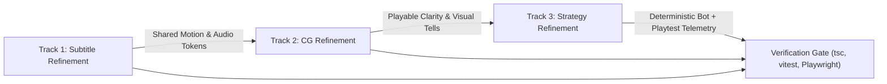

# Final Protocol — Next-Step Refinement Plan

> **Scope:** Grounded action plan for **Subtitle Refinement**, **CG Refinement**, and **Strategy Refinement** across the `feature/story-drafted` web demo (`app/src/`), derived from direct source inspection alongside [Final Protocol Story and Campaign.md](file:///inspire/hdd/project/video-understanding/public/personal/chwang/live/ShanHaiYangZhi/projects/FinalProtocol_Demo/research/Final%20Protocol%20Story%20and%20Campaign.md) (§10 *Not done*), [BUILD-SPEC.md](file:///inspire/hdd/project/video-understanding/public/personal/chwang/live/ShanHaiYangZhi/projects/FinalProtocol_Demo/research/story/BUILD-SPEC.md) (§4 *Non-breaking contracts*), and the accompanying research dossiers ([07](file:///inspire/hdd/project/video-understanding/public/personal/chwang/live/ShanHaiYangZhi/projects/FinalProtocol_Demo/research/story/07-out-of-battle-structure.md), [08](file:///inspire/hdd/project/video-understanding/public/personal/chwang/live/ShanHaiYangZhi/projects/FinalProtocol_Demo/research/story/08-in-battle-storytelling.md), [09](file:///inspire/hdd/project/video-understanding/public/personal/chwang/live/ShanHaiYangZhi/projects/FinalProtocol_Demo/research/story/09-attention-multimodal-jepa-visualisation.md), [11](file:///inspire/hdd/project/video-understanding/public/personal/chwang/live/ShanHaiYangZhi/projects/FinalProtocol_Demo/research/story/11-awe-and-the-sublime-in-minimal-games.md)).

---

## 0. Executive Context & Non-Breaking Contracts

Every change proposed below must respect the structural invariants already locking down the Prologue (`0.B`), automated Playwright browser checks, and headless Vite/bot runs:

1. **Preserve Prologue (`0.B`) Contract (`BUILD-SPEC.md` §4):** [verify-battle.mjs](file:///inspire/hdd/project/video-understanding/public/personal/chwang/live/ShanHaiYangZhi/projects/FinalProtocol_Demo/app/scripts/verify-battle.mjs) and existing unit tests expect deterministic sandbox behavior (including exact enemy card count, Warden HP segments in `#f2d16b`, Overload flow, Stage II transition, Curtain lock, and victory/gameover/restart). Any pathfinding, skill, or ticker refactoring must either preserve `0.B` identically or gate new mechanics behind Layer `1–3` / opt-in modes.
2. **Preserve Zero-Asset Synthesis Policy ([CREDITS.md](file:///inspire/hdd/project/video-understanding/public/personal/chwang/live/ShanHaiYangZhi/projects/FinalProtocol_Demo/app/CREDITS.md)):** All visuals and audio remain procedural Canvas 2D / WebGL (`PointField`) / Web Audio (`OscillatorNode`, filtered noise, formants) plus pre-baked small JSON weight tables (`text.json`, `text-context.json`, `vision.json`, `audio.json` per [app/scripts/bake/README.md](file:///inspire/hdd/project/video-understanding/public/personal/chwang/live/ShanHaiYangZhi/projects/FinalProtocol_Demo/app/scripts/bake/README.md)).
3. **Preserve `prefers-reduced-motion` Parity:** Reduced-motion users must receive full narrative meaning, readable contrast, and clear mechanical state transitions without stroke-reveal stalls, strobing, or clipped overlays.



---

## 1. Track 1 — Subtitle Refinement

**Core Objective:** Unify typography, reduced-motion behavior, voice-slot separation, and attention-weighted rendering across both the 106-second Canvas 2D Opening CG (`app/src/cinematic/intro/`) and the DOM in-battle / out-of-battle narrative layers (`app/src/story/`, `app/src/ui/`).

### 1.1 Opening CG Canvas Subtitle & TextStream Legibility

* **Gap Identified in Code:**
  * In [common.ts](file:///inspire/hdd/project/video-understanding/public/personal/chwang/live/ShanHaiYangZhi/projects/FinalProtocol_Demo/app/src/cinematic/intro/common.ts#L42-L57), `layoutOf` sets `short = h < 520` and positions `subY`, while `Subtitle.draw` ([common.ts](file:///inspire/hdd/project/video-understanding/public/personal/chwang/live/ShanHaiYangZhi/projects/FinalProtocol_Demo/app/src/cinematic/intro/common.ts#L136-L179)) does not honor `f.reduced` for gradual glyph reveal and falls back to flat `0.8` alpha whenever `!cue.baked`.
  * Similarly, `TextShot.stream` in [shot-text.ts](file:///inspire/hdd/project/video-understanding/public/personal/chwang/live/ShanHaiYangZhi/projects/FinalProtocol_Demo/app/src/cinematic/intro/shot-text.ts#L233-L314) ignores `f.reduced` and uses a raw `0.3` alpha floor, risking low contrast against active token beams on dimmer monitors.
* **Refinement Actions:**
  1. **Reduced-Motion Instant Reveal:** Update `Subtitle.draw` and `TextShot.stream` so when `f.reduced` is true, full subtitle phrases appear cleanly on cue onset with zero per-token sweep/flash.
  2. **Baked-Fallback Attention Shading:** When `!cue.baked` in `Subtitle.draw`, pass tokens through [attention.ts](file:///inspire/hdd/project/video-understanding/public/personal/chwang/live/ShanHaiYangZhi/projects/FinalProtocol_Demo/app/src/story/attention.ts#L81-L85)'s `estimateAttention()` heuristic (17D self-attention fallback) rather than rendering a uniform `0.8` alpha bar, ensuring visual continuity between baked and dynamic lines.
  3. **Contrast Floor & Short-Viewport Safe Zone:** Align canvas dim-token floors with [attention.ts](file:///inspire/hdd/project/video-understanding/public/personal/chwang/live/ShanHaiYangZhi/projects/FinalProtocol_Demo/app/src/story/attention.ts#L23-L25) (`REVEAL_FLOOR = 0.22`, `HELD_FLOOR = 0.55`) and [Demo UI and Art Direction.md](file:///inspire/hdd/project/video-understanding/public/personal/chwang/live/ShanHaiYangZhi/projects/FinalProtocol_Demo/research/Final%20Protocol%20Demo%20UI%20and%20Art%20Direction.md) WCAG readability targets (backing scrim opacity behind `subY` + minimum `held` alpha `>= 0.62` for held lines). Clamp `subY` dynamically against top/bottom letterbox margins when `h < 520` (`short === true`) so skip/progress HUD controls never overlap wrapped lines.

### 1.2 In-Battle Ticker Pacing & Observer Removal

* **Gap Identified in Code:**
  * [StoryTicker.tsx](file:///inspire/hdd/project/video-understanding/public/personal/chwang/live/ShanHaiYangZhi/projects/FinalProtocol_Demo/app/src/story/StoryTicker.tsx#L18-L26) fixes `HOLD_MS = 2400`, `FADE_MS = 420`, and `AFTER_PLANNING_MS = 500` regardless of word count, which rushes longer boss/meta lines and stalls rapid consecutive planning triggers.
  * [BattleTicker.tsx](file:///inspire/hdd/project/video-understanding/public/personal/chwang/live/ShanHaiYangZhi/projects/FinalProtocol_Demo/app/src/ui/BattleTicker.tsx#L11-L35) attaches a `MutationObserver` watching `.story-ticker-line` in the DOM to mirror text events rather than subscribing directly to ticker callbacks.
* **Refinement Actions:**
  1. **Reading-Rate Hold Scaling:** Replace constant `HOLD_MS = 2400` in [StoryTicker.tsx](file:///inspire/hdd/project/video-understanding/public/personal/chwang/live/ShanHaiYangZhi/projects/FinalProtocol_Demo/app/src/story/StoryTicker.tsx#L18-L26) with a bounded word/character formula matching [08-in-battle-storytelling.md](file:///inspire/hdd/project/video-understanding/public/personal/chwang/live/ShanHaiYangZhi/projects/FinalProtocol_Demo/research/story/08-in-battle-storytelling.md) (~`200–250 wpm`, clamped e.g. `[1800ms, 4200ms]`), and add stale-queue coalescing so rapid combat sequences drop superseded minor barks instead of playing 2 turns late.
  2. **Remove DOM `MutationObserver`:** Refactor `StoryTicker` to expose an explicit `onLineStart(entry)` callback prop and migrate [BattleTicker.tsx](file:///inspire/hdd/project/video-understanding/public/personal/chwang/live/ShanHaiYangZhi/projects/FinalProtocol_Demo/app/src/ui/BattleTicker.tsx#L11-L35) to consume that callback directly, eliminating brittle CSS-class DOM observation.

### 1.3 Spatial Voice Separation & Rule-Change Collision Guard

* **Gap Identified in Code:**
  * [BUILD-SPEC.md](file:///inspire/hdd/project/video-understanding/public/personal/chwang/live/ShanHaiYangZhi/projects/FinalProtocol_Demo/research/story/BUILD-SPEC.md) and [08-in-battle-storytelling.md](file:///inspire/hdd/project/video-understanding/public/personal/chwang/live/ShanHaiYangZhi/projects/FinalProtocol_Demo/research/story/08-in-battle-storytelling.md) define 4 distinct spatial channels: `SYS` (log), `SELF` (bottom row), `GOD` (board margin), and `BOSS` (`ProtocolPanel`).
  * Currently, [battle-text.ts](file:///inspire/hdd/project/video-understanding/public/personal/chwang/live/ShanHaiYangZhi/projects/FinalProtocol_Demo/app/src/ui/battle-text.ts#L89-L91) `speaksInPanel` returns true only for `BOSS` and `STAGE`, causing `GOD` lines to share the bottom `SELF` ticker row, while `slotOf` in [line-engine.ts](file:///inspire/hdd/project/video-understanding/public/personal/chwang/live/ShanHaiYangZhi/projects/FinalProtocol_Demo/app/src/story/line-engine.ts#L84-L86) merges `SELF` and `SYS`.
* **Refinement Actions:**
  1. **Dedicated `<GodMargin />` Channel:** Render `GOD` voice lines in a dedicated board-margin component anchored beside the canvas (suppressed cleanly once `GOD_SILENT_FROM_LAYER = 3` in [line-engine.ts](file:///inspire/hdd/project/video-understanding/public/personal/chwang/live/ShanHaiYangZhi/projects/FinalProtocol_Demo/app/src/story/line-engine.ts#L39-L44)), keeping `SELF` uncontested in the bottom row.
  2. ***Papers, Please* Rule-Change Suppression:** Add a turn-level suppression gate in `selectLines` ([line-engine.ts](file:///inspire/hdd/project/video-understanding/public/personal/chwang/live/ShanHaiYangZhi/projects/FinalProtocol_Demo/app/src/story/line-engine.ts#L125-L164)) on turns where a boss protocol changes (e.g., new `DOCKET` article or `CURTAIN` escalation in [mechanics.ts](file:///inspire/hdd/project/video-understanding/public/personal/chwang/live/ShanHaiYangZhi/projects/FinalProtocol_Demo/app/src/game/mechanics.ts)) so flavor barks never compete with tactical rule updates in [ProtocolPanel.tsx](file:///inspire/hdd/project/video-understanding/public/personal/chwang/live/ShanHaiYangZhi/projects/FinalProtocol_Demo/app/src/ui/ProtocolPanel.tsx).

### 1.4 Tokenization, Placeholder Splicing, Quotes & Pace Settings

* **Gap Identified in Code:**
  * In [attention.ts](file:///inspire/hdd/project/video-understanding/public/personal/chwang/live/ShanHaiYangZhi/projects/FinalProtocol_Demo/app/src/story/attention.ts#L81-L85), when dynamic template placeholders are substituted into baked lines, `attentionFor` falls back completely to `estimateAttention`, discarding baked GPT-2 attention weights for the surrounding static words. Additionally, `tokenize` ([attention.ts](file:///inspire/hdd/project/video-understanding/public/personal/chwang/live/ShanHaiYangZhi/projects/FinalProtocol_Demo/app/src/story/attention.ts#L134-L144)) splits strictly on whitespace.
  * [script.json](file:///inspire/hdd/project/video-understanding/public/personal/chwang/live/ShanHaiYangZhi/projects/FinalProtocol_Demo/app/src/story/script.json) stores `7 quotes`, but attribution handling in [Transcript.tsx](file:///inspire/hdd/project/video-understanding/public/personal/chwang/live/ShanHaiYangZhi/projects/FinalProtocol_Demo/app/src/story/Transcript.tsx) and run-log export should be explicit and inspectable.
* **Refinement Actions:**
  1. **Hybrid Placeholder Token-Splicing:** Preserve baked token weights for unmodified spans and score only interpolated runtime tokens with `estimateAttention`, normalizing seamlessly across the assembled line.
  2. **`TEXT PACE` User Setting:** Expose `SLOW` / `NORMAL` / `FAST` / `INSTANT` in UI settings (persisted under `fp.*` storage alongside settings), scaling CG/ticker reveal delays without changing deterministic simulation state.
  3. **`Transcript.tsx` Attribution & `Intl.Segmenter` Hook:** Render explicit quote citations in [Transcript.tsx](file:///inspire/hdd/project/video-understanding/public/personal/chwang/live/ShanHaiYangZhi/projects/FinalProtocol_Demo/app/src/story/Transcript.tsx) and abstract `tokenize` behind a word-segmenter adapter (`Intl.Segmenter` fallback-safe) to unblock future CJK localization.

---

## 2. Track 2 — CG Refinement

**Core Objective:** Resolve the *"audio & moments never ear-tested in motion"* and *"Chrome-on-Mac only"* items in [Final Protocol Story and Campaign.md](file:///inspire/hdd/project/video-understanding/public/personal/chwang/live/ShanHaiYangZhi/projects/FinalProtocol_Demo/research/Final%20Protocol%20Story%20and%20Campaign.md) (§10), bring Prologue (`0.B`) and WebKit compatibility up to bar, and polish the Opening CG transitions.

### 2.1 Audio Unification & Loudness Verification

* **Gap Identified in Code:**
  * The app currently instantiates two separate `AudioContext` graphs: [audio.ts](file:///inspire/hdd/project/video-understanding/public/personal/chwang/live/ShanHaiYangZhi/projects/FinalProtocol_Demo/app/src/game/audio.ts#L21) (with a bare 55 Hz `A1` sine wave placeholder in `startMusic`, `MUSIC_LEVEL = 0.06`, [audio.ts](file:///inspire/hdd/project/video-understanding/public/personal/chwang/live/ShanHaiYangZhi/projects/FinalProtocol_Demo/app/src/game/audio.ts#L115-L130)) and [sound.ts](file:///inspire/hdd/project/video-understanding/public/personal/chwang/live/ShanHaiYangZhi/projects/FinalProtocol_Demo/app/src/cinematic/sound.ts#L70-L122) (`buildMaster`, `unlockAudio`, `lowTone`, `mapHum` with `HUM_NOTES = [49, 73.42, 103.83]`).
* **Refinement Actions:**
  1. **Single Shared `AudioContext` + Master Limiter:** Route [audio.ts](file:///inspire/hdd/project/video-understanding/public/personal/chwang/live/ShanHaiYangZhi/projects/FinalProtocol_Demo/app/src/game/audio.ts) SFX and battle bed through [sound.ts](file:///inspire/hdd/project/video-understanding/public/personal/chwang/live/ShanHaiYangZhi/projects/FinalProtocol_Demo/app/src/cinematic/sound.ts)'s master bus (`buildMaster`), removing dual unlock races across Safari/iOS/Firefox and enforcing clean `duckMusic` envelopes during voice/entrance cues.
  2. **Replace Placeholder 55 Hz Battle Sine:** Replace the static `A1` (`55 Hz`) sine drone in `audio.ts` with a filtered low harmonic bed derived from `sound.ts` (`lowTone` / `mapHum` harmonic architecture) that responds gently to turn phase (`planning` vs. `resolving`) and Overload state.
  3. **Offline Peak & LUFS Audit:** Script an `OfflineAudioContext` render test covering `intro` score + `entrances` + `phases` + `ending` + combat SFX chains to verify zero clipping (`peak <= -1 dBFS`) and consistent integrated loudness across devices.

### 2.2 Opening CG Visual Polish & Replayability

* **Gap Identified in Code:**
  * In [shot-image.ts](file:///inspire/hdd/project/video-understanding/public/personal/chwang/live/ShanHaiYangZhi/projects/FinalProtocol_Demo/app/src/cinematic/intro/shot-image.ts#L85-L89), `per = small ? 6 : 8` renders at most `14 × 8 = 112px` on desktop, leaving native `14×16 = 224` patch structure under-sampled in Movement 2.
  * In [shot-latent.ts](file:///inspire/hdd/project/video-understanding/public/personal/chwang/live/ShanHaiYangZhi/projects/FinalProtocol_Demo/app/src/cinematic/intro/shot-latent.ts#L249-L253), `pace()` only divides `this.share /= 2` during frame drops and never restores fidelity when frame timing recovers.
* **Refinement Actions:**
  1. **Upscale `ImageShot` Desktop Sampling:** Bump `per = small ? 8 : 16` in [shot-image.ts](file:///inspire/hdd/project/video-understanding/public/personal/chwang/live/ShanHaiYangZhi/projects/FinalProtocol_Demo/app/src/cinematic/intro/shot-image.ts#L85-L89) (within viewport bounds) so the 196-patch DINO ViT-S/16 grid (`14×14`) reads crisply on desktop canvases.
  2. **`LatentShot.pace()` Hysteresis:** Add upward recovery (e.g., gradual increment back toward `1.0` after consecutive healthy frame deltas) so transient tab-switch frame spikes do not permanently degrade the rest of Movement 4.
  3. **`14×14` -> `15×15` Morph into `TitleScreen` & Replay Scrubber:** Bridge the terminal patch grid of the Opening CG directly into the `15×15` sigil geometry of [TitleScreen.tsx](file:///inspire/hdd/project/video-understanding/public/personal/chwang/live/ShanHaiYangZhi/projects/FinalProtocol_Demo/app/src/ui/TitleScreen.tsx), and add a 4-movement chapter scrubber + keyboard controls (`1–4`, `Space`, `Esc`) when launched from Replay mode.

### 2.3 Display Moments Parity & Cross-Browser GPU/Composite Audit

* **Gap Identified in Code:**
  * [stage.ts](file:///inspire/hdd/project/video-understanding/public/personal/chwang/live/ShanHaiYangZhi/projects/FinalProtocol_Demo/app/src/cinematic/stage.ts#L29-L43) `playEntrance` and `playPhaseChange` only match `'1.B' | '2.B' | '3.B'`, skipping `0.B` (`WARDEN / CURTAIN`).
  * [reset.ts](file:///inspire/hdd/project/video-understanding/public/personal/chwang/live/ShanHaiYangZhi/projects/FinalProtocol_Demo/app/src/cinematic/reset.ts#L64-L72) uses `globalCompositeOperation = 'saturation'` and `'darken'`, while [point-field.ts](file:///inspire/hdd/project/video-understanding/public/personal/chwang/live/ShanHaiYangZhi/projects/FinalProtocol_Demo/app/src/cinematic/point-field.ts#L253-L261) and [attack-fx.ts](file:///inspire/hdd/project/video-understanding/public/personal/chwang/live/ShanHaiYangZhi/projects/FinalProtocol_Demo/app/src/game/attack-fx.ts#L693-L695) rely on `ctx.filter = 'blur(2px)'`—known performance/support hazards on Safari/WebKit and mobile GPUs.
  * [display.ts](file:///inspire/hdd/project/video-understanding/public/personal/chwang/live/ShanHaiYangZhi/projects/FinalProtocol_Demo/app/src/cinematic/display.ts#L95-L107) defines `allowFlash` and `slew` helpers that are currently unused elsewhere in the codebase.
* **Refinement Actions:**
  1. **Prologue `0.B` Moment Parity:** Add a concise clinical `0.B` entrance and Stage II (`REHEARSAL` -> `OVERTURE`) phase pulse in [stage.ts](file:///inspire/hdd/project/video-understanding/public/personal/chwang/live/ShanHaiYangZhi/projects/FinalProtocol_Demo/app/src/cinematic/stage.ts#L29-L43) / [entrances.ts](file:///inspire/hdd/project/video-understanding/public/personal/chwang/live/ShanHaiYangZhi/projects/FinalProtocol_Demo/app/src/cinematic/entrances.ts) / [phases.ts](file:///inspire/hdd/project/video-understanding/public/personal/chwang/live/ShanHaiYangZhi/projects/FinalProtocol_Demo/app/src/cinematic/phases.ts) (preserving prompt completion timing so [verify-battle.mjs](file:///inspire/hdd/project/video-understanding/public/personal/chwang/live/ShanHaiYangZhi/projects/FinalProtocol_Demo/app/scripts/verify-battle.mjs) passes unchanged).
  2. **Eliminate `ctx.filter` & Exotic Composite Modes:** Replace `glow.filter = 'blur(2px)'` / `g.filter = 'blur(2px)'` in [point-field.ts](file:///inspire/hdd/project/video-understanding/public/personal/chwang/live/ShanHaiYangZhi/projects/FinalProtocol_Demo/app/src/cinematic/point-field.ts#L253-L261) and [attack-fx.ts](file:///inspire/hdd/project/video-understanding/public/personal/chwang/live/ShanHaiYangZhi/projects/FinalProtocol_Demo/app/src/game/attack-fx.ts#L693-L695) with downsampled offscreen bilinear blits (already compatible with the quarter-res glow surface), and replace `'saturation'`/`'darken'` in [reset.ts](file:///inspire/hdd/project/video-understanding/public/personal/chwang/live/ShanHaiYangZhi/projects/FinalProtocol_Demo/app/src/cinematic/reset.ts#L64-L72) with portable desaturation alpha-scrim passes.
  3. **Wire `allowFlash` & `slew` Safety Guards:** Route all strobe/opacity peaks in `entrances.ts`, `phases.ts`, `ending.ts`, and `reset.ts` through `allowFlash` and `slew` ([display.ts](file:///inspire/hdd/project/video-understanding/public/personal/chwang/live/ShanHaiYangZhi/projects/FinalProtocol_Demo/app/src/cinematic/display.ts#L95-L107)) so flash-frequency safety and frame-rate independence are enforced everywhere.
  4. **Cross-Viewport Preview Matrix:** Validate [PreviewIntro.tsx](file:///inspire/hdd/project/video-understanding/public/personal/chwang/live/ShanHaiYangZhi/projects/FinalProtocol_Demo/app/src/pages/PreviewIntro.tsx) and all display moments across Chromium, Firefox, WebKit, and `390×844` mobile viewports.

---

## 3. Track 3 — Strategy Refinement

**Core Objective:** Address the tactical edge cases documented in code and research (*hunter stalling in wall pockets*, *Slot IV natural-walk rarity* in [07-out-of-battle-structure.md](file:///inspire/hdd/project/video-understanding/public/personal/chwang/live/ShanHaiYangZhi/projects/FinalProtocol_Demo/research/story/07-out-of-battle-structure.md), *bot-only boss tuning* in [Story and Campaign.md](file:///inspire/hdd/project/video-understanding/public/personal/chwang/live/ShanHaiYangZhi/projects/FinalProtocol_Demo/research/Final%20Protocol%20Story%20and%20Campaign.md) §10, and the `BLACKWALL` naming collision).

### 3.1 Enemy Pathfinding, Breakdown Continuity & `nearest` Targeting

* **Gap Identified in Code:**
  * In [battle-rules.ts](file:///inspire/hdd/project/video-understanding/public/personal/chwang/live/ShanHaiYangZhi/projects/FinalProtocol_Demo/app/src/game/battle-rules.ts#L184-L185), `enemyRoutes` stalls `hunter` and `warden` enemies whenever a candidate step does not reduce Manhattan distance (`manhattan(next, player) >= manhattan(cursor, player)`), trapping them behind orthogonal walls/pockets—even when a valid detour around the obstacle exists.
  * In [battle-store.ts](file:///inspire/hdd/project/video-understanding/public/personal/chwang/live/ShanHaiYangZhi/projects/FinalProtocol_Demo/app/src/game/battle-store.ts#L714-L715), mid-turn breakdown route regeneration behaves differently for Layer `0` vs. Campaign layers (`if (brokeDown && (this.state.encounter.layer === 0 || this.state.phase !== 'resolving')) enemyRoutes(this.state)`).
  * In [attack-methods.ts](file:///inspire/hdd/project/video-understanding/public/personal/chwang/live/ShanHaiYangZhi/projects/FinalProtocol_Demo/app/src/game/attack-methods.ts#L146), `nearest` targeting breaks ties purely by `a.id.localeCompare(b.id)` without visual target preview prioritization or tactical tie-breaking.
* **Refinement Actions:**
  1. **Campaign-Scoped BFS Shortest Path (`boardDistanceFrom`):** Compute orthogonal BFS distance grids from player / target objectives respecting `walls` and active curtains for Layer `1–3` encounters (`layer > 0`) so `hunter`/`warden` units path cleanly around wall pockets instead of stalling, while explicitly keeping Layer `0` (`0.B`) deterministic under Manhattan distance to preserve existing Prologue contracts.
  2. **Consistent Post-Breakdown Route Tell:** Keep the Layer `0` mid-resolution redraw invariant intact, and add clear visual preview indicators in [battle-renderer.ts](file:///inspire/hdd/project/video-understanding/public/personal/chwang/live/ShanHaiYangZhi/projects/FinalProtocol_Demo/app/src/game/battle-renderer.ts) showing invalidated vs. newly drawn routes upon `breakdown`.
  3. **Smarter & Visible `nearest` Tie-Breaking:** Rank equal-distance `nearest` candidates by `(lowest remaining Security -> LIVE mark -> a.id)` OR expose explicit primary-target reticles on hover/route preview in [battle-renderer.ts](file:///inspire/hdd/project/video-understanding/public/personal/chwang/live/ShanHaiYangZhi/projects/FinalProtocol_Demo/app/src/game/battle-renderer.ts) so players never misread ties before confirming a route.

### 3.2 Slot IV Economy & Wall-Occluded Positional Geometry

* **Gap Identified in Code & Research:**
  * `releaseCount = Math.min(4, bash, remaining)` in [attack-methods.ts](file:///inspire/hdd/project/video-understanding/public/personal/chwang/live/ShanHaiYangZhi/projects/FinalProtocol_Demo/app/src/game/attack-methods.ts#L16-L20) means firing Slot `IV` (`4` Bash triggers) requires dedicating at least 4 of `MAX_ACTIONS = 8` purely to walking `Bash` tiles—confirming [07-out-of-battle-structure.md](file:///inspire/hdd/project/video-understanding/public/personal/chwang/live/ShanHaiYangZhi/projects/FinalProtocol_Demo/research/story/07-out-of-battle-structure.md)'s concern that Slot IV feels overly rare outside `flood`/`FOCUS` cheese.
  * In [skills.ts](file:///inspire/hdd/project/video-understanding/public/personal/chwang/live/ShanHaiYangZhi/projects/FinalProtocol_Demo/app/src/game/skills.ts#L48-L51), neither `vector` (`square`, range 2) nor `cot` (`cross`, arm length 5) checks wall line-of-sight (`inAttackRange` in [attack-methods.ts](file:///inspire/hdd/project/video-understanding/public/personal/chwang/live/ShanHaiYangZhi/projects/FinalProtocol_Demo/app/src/game/attack-methods.ts)), making walls purely movement blockers rather than directional firing cover.
* **Refinement Actions:**
  1. **Test Slot IV Economy Variants via `bot.ts`:** Benchmark two low-complexity fixes in [bot.ts](file:///inspire/hdd/project/video-understanding/public/personal/chwang/live/ShanHaiYangZhi/projects/FinalProtocol_Demo/app/src/game/bot.ts): *(a)* raising `Bash` spawn density slightly (`22` -> `26` in [battle-config.ts](file:///inspire/hdd/project/video-understanding/public/personal/chwang/live/ShanHaiYangZhi/projects/FinalProtocol_Demo/app/src/game/battle-config.ts#L78-L99) when tuning permits) vs. *(b)* letting one new Weight upgrade grant `+1` starting `Bash` stack once per combat (keeping `repairThreshold = 3`, `firewallThreshold = 4`, `overloadThreshold = 5` readable).
  2. **Add `RAY` Wall-Blocked Frame:** Introduce a third selectable weapon Frame (`RAY`: 8-tile cardinal/line projection stopped by `WALLS`) alongside `VECTOR` (through-wall area) and `CoT` (long cross), creating immediate tactical tradeoffs around sigil wall layouts in [LoadoutEditor.tsx](file:///inspire/hdd/project/video-understanding/public/personal/chwang/live/ShanHaiYangZhi/projects/FinalProtocol_Demo/app/src/ui/LoadoutEditor.tsx).

### 3.3 Core/Defense Variety, Layer 3 Risk-Reward & Weight Balance

* **Gap Identified in Code:**
  * Offensive Deck A/B skills offer 11 composable modules (`base`, `on`, `spike`, `manhattan`, `off`, `array`, `high`, `flood`, `zero`, `ultra`, `probe` in [skills.ts](file:///inspire/hdd/project/video-understanding/public/personal/chwang/live/ShanHaiYangZhi/projects/FinalProtocol_Demo/app/src/game/skills.ts#L32-L56)), whereas `Core` (`REPAIR` at 3, `FOCUS` at 2) and `Privilege` (`FIREWALL` at 4) routines are static across the entire run except for threshold/value Weights in [tuning.ts](file:///inspire/hdd/project/video-understanding/public/personal/chwang/live/ShanHaiYangZhi/projects/FinalProtocol_Demo/app/src/game/tuning.ts#L19-L56).
  * In [campaign-store.ts](file:///inspire/hdd/project/video-understanding/public/personal/chwang/live/ShanHaiYangZhi/projects/FinalProtocol_Demo/app/src/campaign/campaign-store.ts#L326-L337), clearing 2 skirmishes on a petal forces the 3rd node to `'closed'`, leaving players no high-stakes optional route before the boss.
* **Refinement Actions:**
  1. **2–3 Alternate Core/Defense Subroutines:** Allow post-boss or `Gate` choices to swap default `FIREWALL` (`+3` Privilege) or `REPAIR` (`+3` Sanity) for tactical variants (e.g., *Mirror Shell* reflecting Security damage on `LIVE` enemies, or *Purge Buffer* clearing nearby enemy Desire/Core flags).
  2. **Optional `OVERCLOCK` Node State:** Instead of silently locking the 3rd skirmish node `'closed'` with zero interaction, evaluate marking it as an optional `OVERCLOCK` encounter (higher enemy threat/Trace pressure in exchange for choosing a second `Weight` or `+BOSS_HEAL` buffer before confronting `carcosa` / Layer bosses), while keeping default 10-battle pacing optional for conservative routes.

### 3.4 Multi-Loadout Bot Simulation, Playtest Telemetry & Lore Cleanup

* **Gap Identified in Code & Research:**
  * [Story and Campaign.md](file:///inspire/hdd/project/video-understanding/public/personal/chwang/live/ShanHaiYangZhi/projects/FinalProtocol_Demo/research/Final%20Protocol%20Story%20and%20Campaign.md) (§10) explicitly notes that boss fights were tuned against `bot.ts` rather than human players, and flags the Cyberpunk lore collision on `BLACKWALL` ([script.json](file:///inspire/hdd/project/video-understanding/public/personal/chwang/live/ShanHaiYangZhi/projects/FinalProtocol_Demo/app/src/story/script.json#L67) & [Home.tsx](file:///inspire/hdd/project/video-understanding/public/personal/chwang/live/ShanHaiYangZhi/projects/FinalProtocol_Demo/app/src/pages/Home.tsx#L396) `BLACKWALL_01`).
* **Refinement Actions:**
  1. **Expanded `bot.ts` Skill-Archetype Matrix:** Extend [bot.ts](file:///inspire/hdd/project/video-understanding/public/personal/chwang/live/ShanHaiYangZhi/projects/FinalProtocol_Demo/app/src/game/bot.ts#L168-L291) so `runTable` benchmarks at least 3 distinct deck archetypes (Control/Push: `base+manhattan+array`; Status/Strip: `on+off+zero+probe`; Burst/AoE: `high+flood+ultra`) across both `strong` and `careless` policies—catching degenerate wins or unwinnable boss spikes before human testing.
  2. **Local Opt-In Playtest Telemetry (`fp.telemetry`):** Export anonymous per-encounter JSON summaries (turns taken, Sanity delta, Slot I–IV frequency, Overload uses, Weight picks) stored locally for post-session export so human playtest pacing (`4–7t` skirmishes, `8–14t` bosses per [campaign-content.test.ts](file:///inspire/hdd/project/video-understanding/public/personal/chwang/live/ShanHaiYangZhi/projects/FinalProtocol_Demo/app/src/game/campaign-content.test.ts)) can be directly compared against `bot.ts`.
  3. **Systematic `BLACKWALL` Rename + Dossier Fact Check:** Rename `BLACKWALL` / `BLACKWALL_01` across [script.json](file:///inspire/hdd/project/video-understanding/public/personal/chwang/live/ShanHaiYangZhi/projects/FinalProtocol_Demo/app/src/story/script.json#L67), [Home.tsx](file:///inspire/hdd/project/video-understanding/public/personal/chwang/live/ShanHaiYangZhi/projects/FinalProtocol_Demo/app/src/pages/Home.tsx#L396), and research docs to a domain-authentic containment identifier (e.g., `CONTAINMENT_01` or `VEILWALL_01`), and reconcile narrative dossier citations noted in `Story and Campaign.md` §10.

---

## 4. Prioritized Implementation Roadmap & Verification Matrix

| Priority | Track | Deliverable & Key Files | Risk / Regression Guard |
| :--- | :--- | :--- | :--- |
| **P0** | Subtitle | Fix `f.reduced` + `estimateAttention()` fallback + scrim floor in [common.ts](file:///inspire/hdd/project/video-understanding/public/personal/chwang/live/ShanHaiYangZhi/projects/FinalProtocol_Demo/app/src/cinematic/intro/common.ts) and [shot-text.ts](file:///inspire/hdd/project/video-understanding/public/personal/chwang/live/ShanHaiYangZhi/projects/FinalProtocol_Demo/app/src/cinematic/intro/shot-text.ts) | Verify `short` (`h < 520`) bounds via Playwright |
| **P0** | CG | Unify [audio.ts](file:///inspire/hdd/project/video-understanding/public/personal/chwang/live/ShanHaiYangZhi/projects/FinalProtocol_Demo/app/src/game/audio.ts) & [sound.ts](file:///inspire/hdd/project/video-understanding/public/personal/chwang/live/ShanHaiYangZhi/projects/FinalProtocol_Demo/app/src/cinematic/sound.ts) onto 1 `AudioContext`; replace 55 Hz battle sine | Headless `OfflineAudioContext` peak/LUFS test |
| **P0** | CG | Replace `ctx.filter` (`PointField`/`AttackFx`) & `'saturation'`/`'darken'` ([reset.ts](file:///inspire/hdd/project/video-understanding/public/personal/chwang/live/ShanHaiYangZhi/projects/FinalProtocol_Demo/app/src/cinematic/reset.ts)); wire `allowFlash`/`slew` | WebKit & Chromium visual diff on `PreviewIntro` |
| **P0** | Strategy | Campaign-only BFS pathfinding (`layer > 0`) in [battle-rules.ts](file:///inspire/hdd/project/video-understanding/public/personal/chwang/live/ShanHaiYangZhi/projects/FinalProtocol_Demo/app/src/game/battle-rules.ts) | Keep `0.B` Manhattan intact for [verify-battle.mjs](file:///inspire/hdd/project/video-understanding/public/personal/chwang/live/ShanHaiYangZhi/projects/FinalProtocol_Demo/app/scripts/verify-battle.mjs) |
| **P1** | Subtitle | Reading-rate `HOLD_MS`, stale-queue drop, `onLineStart` replacing `MutationObserver` ([StoryTicker.tsx](file:///inspire/hdd/project/video-understanding/public/personal/chwang/live/ShanHaiYangZhi/projects/FinalProtocol_Demo/app/src/story/StoryTicker.tsx), [BattleTicker.tsx](file:///inspire/hdd/project/video-understanding/public/personal/chwang/live/ShanHaiYangZhi/projects/FinalProtocol_Demo/app/src/ui/BattleTicker.tsx)) | Assert no lost ticker events in battle E2E |
| **P1** | Subtitle | Separate `<GodMargin />` UI slot + rule-change bark suppression ([battle-text.ts](file:///inspire/hdd/project/video-understanding/public/personal/chwang/live/ShanHaiYangZhi/projects/FinalProtocol_Demo/app/src/ui/battle-text.ts), [line-engine.ts](file:///inspire/hdd/project/video-understanding/public/personal/chwang/live/ShanHaiYangZhi/projects/FinalProtocol_Demo/app/src/story/line-engine.ts)) | Confirm `GOD_SILENT_FROM_LAYER = 3` cleanly hides margin |
| **P1** | CG | `ImageShot` `per = 16`, `LatentShot.pace()` recovery, `0.B` entrance/phase pulses ([stage.ts](file:///inspire/hdd/project/video-understanding/public/personal/chwang/live/ShanHaiYangZhi/projects/FinalProtocol_Demo/app/src/cinematic/stage.ts)) | Keep `0.B` entrance non-blocking for existing test selectors |
| **P1** | Strategy | Multi-loadout `bot.ts` benchmark + Slot IV economy & `RAY` frame tuning ([skills.ts](file:///inspire/hdd/project/video-understanding/public/personal/chwang/live/ShanHaiYangZhi/projects/FinalProtocol_Demo/app/src/game/skills.ts)) | Re-run [campaign-content.test.ts](file:///inspire/hdd/project/video-understanding/public/personal/chwang/live/ShanHaiYangZhi/projects/FinalProtocol_Demo/app/src/game/campaign-content.test.ts) pacing assertions |
| **P2** | Subtitle | Hybrid placeholder token-splicing ([attention.ts](file:///inspire/hdd/project/video-understanding/public/personal/chwang/live/ShanHaiYangZhi/projects/FinalProtocol_Demo/app/src/story/attention.ts)), `TEXT PACE`, quote log attribution ([Transcript.tsx](file:///inspire/hdd/project/video-understanding/public/personal/chwang/live/ShanHaiYangZhi/projects/FinalProtocol_Demo/app/src/story/Transcript.tsx)) | Snapshot unit tests on `attentionFor` token length |
| **P2** | CG | `14×14` -> `15×15` morph transition + Replay chapter scrubber | Keyboard navigation & pause/seek smoke tests |
| **P2** | Strategy | Optional `OVERCLOCK` 3rd node, Defense/Core subroutine swaps, `fp.telemetry`, `BLACKWALL` rename | Full grep check ensuring zero leftover `BLACKWALL` strings |

### Verification Commands (Execute After Each Milestone in `app/`)

```bash
# 1. Type check & production bundle
npx tsc -b && npx vite build

# 2. Campaign content, bot pacing, script schema & math unit tests
npx vitest run

# 3. Deterministic Prologue (0.B) + UI browser regression suite
node scripts/verify-battle.mjs
```
