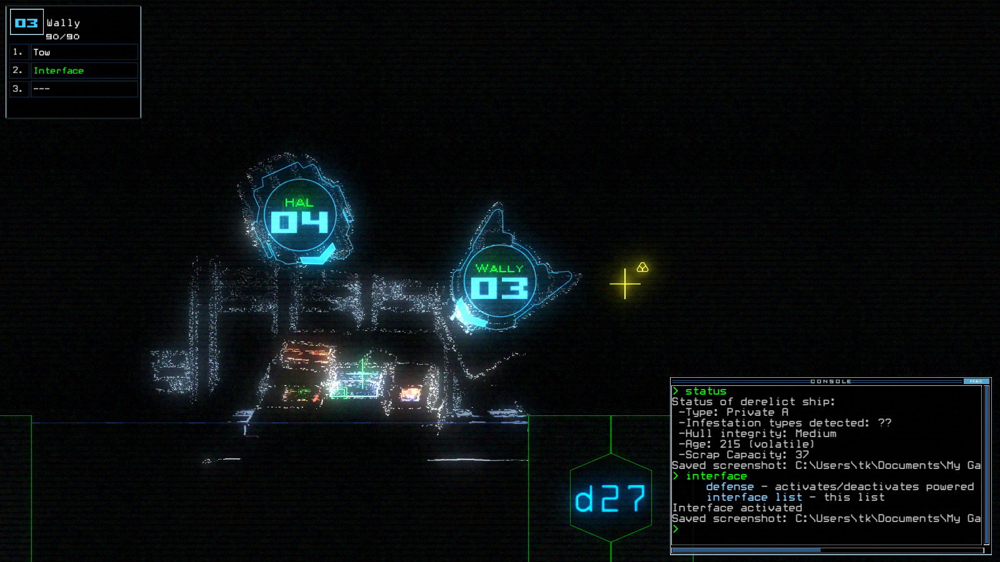
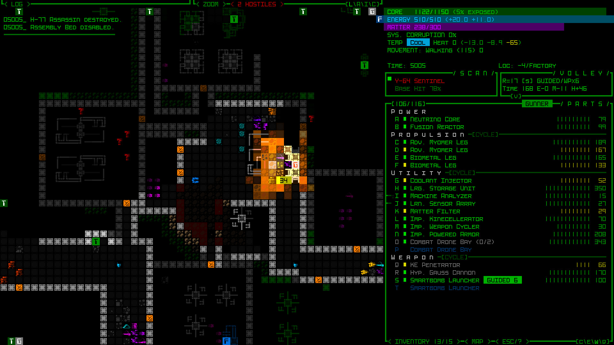
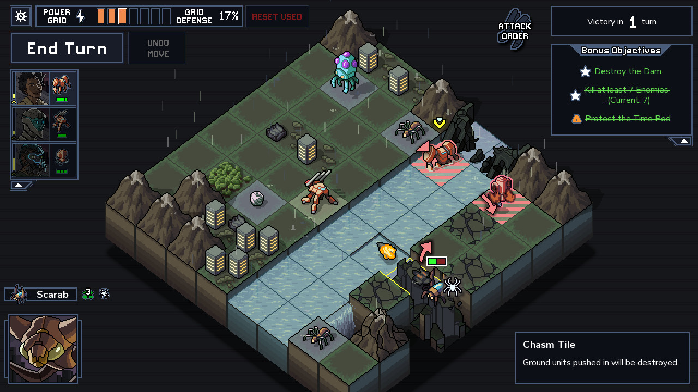
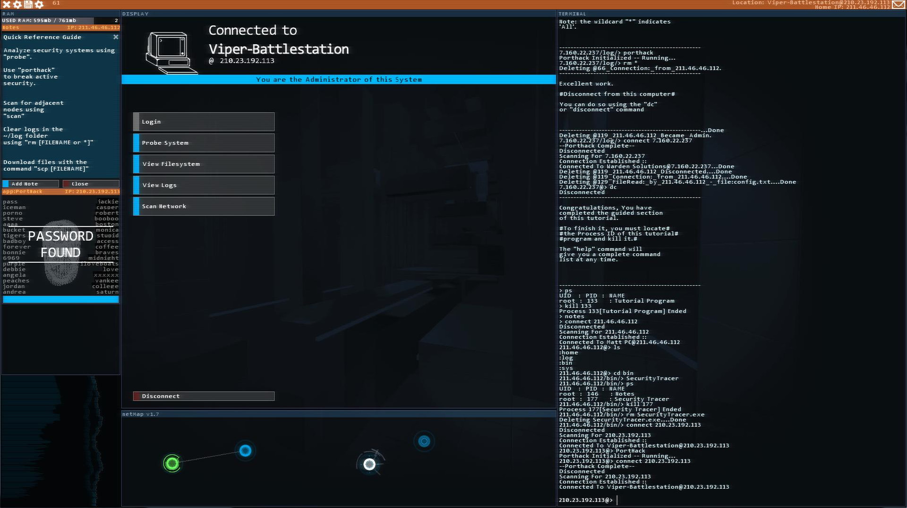

# Final Protocol — Demo UI & Art Direction

**Direction:** Minimalism × Terminal Aesthetics  
**Purpose:** A practical visual specification for the Demo’s battle interface, out-of-battle interface, units, and maps.  
**Design constraint:** The interface must reveal what a route collects, what will fire, and what enemies intend before the player commits.

## Style statement

**Final Protocol should look like a containment operating system that has become a tactical space: austere, precise, and quietly hostile.** The screen is a flat graphite console built from square cells, thin rules, monospace type, and isolated luminous symbols—not a nostalgic CRT covered in noise. Minimalism supplies the hierarchy: the board dominates, the current decision is brightest, and secondary explanation stays out of the way until requested. Terminal aesthetics supply the fiction: resources are processes, enemies are hostile routines, rewards are installed protocols, and the run map is a containment schematic. Color is functional rather than decorative, every resource and unit has a unique silhouette as well as a hue, and motion explains pickups, triggers, drops, and damage in that order. Glow, scanlines, corrupted text, and glitch transitions are optional surface treatment only; they must never blur a number, disguise a route, delay input, or compete with the turn preview.

## 1. Visual thesis and reference lessons

The direction should be described as **“clinical containment,” not “retro hacker.”** A real terminal inspires the alignment, typography, command grammar, and sense of mediated control, but the game does not need to reproduce terminal limitations. Cogmind’s developer notes explicitly distinguish square map cells from more comfortable text presentation and argue for reduced, distinguishable shapes; this supports a hybrid of geometric board glyphs and readable UI text rather than literal ASCII everywhere.[^1^](https://www.gridsagegames.com/blog/2015/04/cogmind-roguelike/) Duskers demonstrates how wireframe rooms, sparse labels, and system-mediated perception can make the interface itself carry the fantasy, while its command-line friction warns against requiring typed input for ordinary actions.[^2^](https://www.rockpapershotgun.com/how-typing-heightens-duskers-deep-space-horror)

Tactical clarity takes precedence over stylistic purity. Into the Breach’s designers constrained attack geometries and changed line treatments after overlapping overlays became difficult to parse; they also favored contextual animated explanations over increasingly complicated text.[^3^](https://www.rockpapershotgun.com/into-the-breach-interface-design) Nielsen Norman Group’s game-focused guidance likewise emphasizes visible status, contextual controls, recognition over recall, and removal of irrelevant information.[^4^](https://www.nngroup.com/articles/usability-heuristics-applied-video-games/) The resulting rule for Final Protocol is simple: **complexity belongs in decisions, not in decoding the screen.** A player should be able to inspect a complicated rules interaction without that complexity becoming permanent visual furniture.

| Reference | Borrow | Do not borrow |
| --- | --- | --- |
| **Duskers** | Remote-operator fiction, schematic rooms, restrained system messages | Mandatory typing, unreadably small text, uncertainty caused by presentation |
| **Cogmind** | Stable square glyphs, discrete silhouettes, mixed map/text typography | Dense all-screen telemetry, excessive animation, intricate connected linework |
| **Into the Breach** | Deterministic intent, distinct trajectory lines, contextual previews | Pixel-art rendering, multiple equal-strength overlays, icon accumulation |
| **Hacknet** | OS-like workspaces, log-driven story delivery, terminal/graphical equivalence | Overlapping windows, decorative desktop clutter, command authenticity for its own sake |

## 2. Core visual system

### Palette and material

Use a nearly black blue-graphite foundation, warm-neutral primary text, and six reserved signal colors. **No element should be identified by color alone.** Attack, Defense, Star, and Shadow each combine a hue, a geometric mark, and a distinct fill or animation behavior; player and enemy ownership additionally differ by outline construction. Normal text should target at least **4.5:1** contrast and meaningful icons or control boundaries at least **3:1**, following WCAG guidance as a production baseline rather than claiming that game UI automatically falls under web conformance.[^5^](https://www.w3.org/WAI/WCAG22/Understanding/contrast-minimum.html) Muted text is for genuinely secondary metadata, never for required values or enemy intent.

Surfaces remain flat: no glassmorphism, soft shadows, bevels, textured metal, bloom-filled panels, or rounded mobile-app cards. One-pixel rules and sparse corner brackets establish structure. A selected panel may gain a slightly lighter fill, while the current interactive object receives a crisp light outline. Scanlines may sit at very low opacity on menu backgrounds, but should be disabled over the tactical board and body text by default. Glitch is a short semantic event associated with a warden action, damage, or layer transition—not an idle filter. This keeps the terminal identity recognizable after all optional CRT treatment is switched off.

| Token | Suggested color | Function | Required non-color cue |
| --- | --- | --- | --- |
| Void | `#070B0D` | Screen background | — |
| Panel | `#0D1418` | UI regions and card backs | One-pixel boundary |
| Grid | `#596B72` | Inactive cell rules | Square geometry |
| Text | `#DCE7E3` | Primary values and labels | — |
| Muted | `#91A39F` | Secondary metadata only | — |
| Player / route | `#8EF6D2` | Player core, planned path, confirm state | Open corner brackets; solid numbered path |
| Attack | `#FF8A5B` | Attack resource and outgoing result | `▲` chevron; upward notch |
| Defense | `#6CCFF6` | Defense resource and Block | `▣` enclosed shield; closed square |
| Star | `#F6D365` | Star resource and counters | `✦` four-point mark; radial ticks |
| Shadow | `#B79CFF` | Shadow resource and switch availability | `◐` half-fill; three diamond pips |
| Enemy / danger | `#FF5C7A` | Enemy cores, incoming damage | Broken hexagon; dashed intent path |
| Focus | `#F4F7F5` | Keyboard cursor and current selection | Double outline and corner marks |

### Typography, iconography, and motion

**JetBrains Mono NL** is the recommended UI family: it is free and open source, designed for reading code, and the NL variant avoids ligatures that could destabilize symbolic values.[^6^](https://www.jetbrains.com/lp/mono/) Use Regular for labels, Medium for values, and Bold only for phase headings, critical warnings, and confirm actions. Uppercase suits short system labels such as `PLAN`, `RESOLVE`, and `WARDEN`, but rules, card descriptions, and story passages should use sentence case. Keep numeric fields tabular and aligned. Square glyphs on the grid can be custom vector marks with an ASCII fallback; text panels should use normal character proportions rather than stretching the map font. Every unfamiliar icon ships with a visible label in its primary location and a tooltip for deeper explanation, because tooltip-only icons increase memory strain.[^7^](https://www.nngroup.com/articles/usability-heuristics-complex-applications/)

Motion is a causal explanation, not ambient decoration. On pickup, the tile mark collapses toward its destination counter; on resolution, attack, defense, and ready Star effects fire in the actual rules order; on drop, marks translate vertically while their column preview empties and refills. Recommended interactions are short and interruptible, and the full automatic sequence should have normal, fast, and reduced-motion modes. Avoid continuous cursor blinking, screen-wide flicker, chromatic separation, and repeated glitch bursts. W3C-aligned accessibility practice supports disabling nonessential interaction motion and keeping flashing below dangerous thresholds.[^8^](https://doc.esri.com/en/accessibility/latest/data-visualization/animation.html) Reduced motion should replace travel with two-state highlights and a concise event log, not remove information.

## 3. UI elements — in battle

### Board-first layout and decision hierarchy

The battle screen should use a stable three-region composition: a narrow player rail on the left, the square board in the center, and a contextual inspector on the right. A slim header identifies the containment layer, encounter, turn, and phase; a bottom command strip holds route editing and confirmation. The board and its immediate previews receive roughly two-thirds of the available width at a desktop target resolution, while the inspector collapses when nothing is selected. The persistent left rail contains Health, Block, the separate **7-action** and **4-step** budgets, active attack method, Attack/Defense stacks, Star counters, and Shadow pips. A three-line event log can sit below the inspector, expanding only on request. This arrangement makes the current route a relationship between the board and predicted outcomes, not a tour through disconnected menus.

Overlay priority must remain strict. Terrain is darkest, resource marks are neutral-bright, enemy routes are dashed and subordinate, the player route is solid and numbered, and the selected end tile receives the strongest frame. Attack reach appears only from the planned endpoint and uses an outlined or hatched treatment rather than another opaque fill. When overlays coincide, the player route wins; hovering or focusing an enemy temporarily promotes that enemy’s route and demotes others. Invalid steps are shown at the attempted cell with a short reason such as `BLOCKED: WALL` or `STEP LIMIT 4`. The UI must support undoing the last step, clearing the route, stopping early, and confirming without requiring a typed command.

```text
┌ LAYER 01 / NODE 03 ─────────────── TURN 04 / PLAN ───────────── HOSTILES 03 ┐
│ PLAYER          │ NEXT:  ▲  ·  ▣  ✦  ◐  ▲  ·              │ INSPECTOR      │
│ HP  42/60       │ ┌───┬───┬───┬───┬───┬───┬───┐          │ E02 / ROUTE    │
│ BLK 08          │ │ ▲ │ · │   │ # │ ▣ │ ✦ │ · │          │ E02─E03─E04   │
│ ACT  ●●●●●○○   │ ├───┼───┼───┼───┼───┼───┼───┤          │ INTENT: ▲ ×2  │
│ STEP 1 2 3 4    │ │   │ 1─┼─2─┼─3─┼─┤E│   │   │          │                │
│ METHOD: LINE    │ │ ◐ │   │   │ # │ 4P│   │   │          │ ROUTE YIELD    │
│ ATT ▲ ×3        │ └───┴───┴───┴───┴───┴───┴───┘          │ ATT 3 → E02   │
│ DEF ▣ ×1        │ planned endpoint + attack reach          │ BLK +1        │
│ STAR ✦ 2/3      │                                          │ ✦ 3/3 READY   │
│ SHADOW ◐◐◇     │                                          │                │
│                 │ [UNDO] [CLEAR] [SWITCH]      [COMMIT >]  │ LOG / DETAILS  │
└─────────────────┴──────────────────────────────────────────┴────────────────┘
```

### Required elements and turn feedback

The column-top previews should read as seven input sockets physically attached to the board, including explicit blank markers; they should not resemble decorative inventory slots. The action orb can become seven compact ticks because an orb competes poorly with the square visual grammar, while the four step pips should be larger and numbered to reinforce that actions and steps are different budgets. Attack and Defense counters display both collected quantity and predicted effect. Each Star effect uses a labeled segmented ring or arc with `current / threshold`, and Shadow uses three pips plus a disabled or enabled `SWITCH` action. Health bars pair a numeric value with a bar, and enemy entries retain stable identifiers so the player can connect an inspector row, a route, and a board unit.

Before confirmation, the result preview should answer three questions in order: **what was collected, what will fire, and what changes.** Show Attack and Defense totals, each Star effect that reaches threshold, the active attack method, its target or affected cells under the current rules, and expected enemy Health/Block deltas. During resolution, highlight one cause and its effect at a time; avoid playing all counters, projectiles, and drops simultaneously. Afterward, leave a compact textual receipt such as `PICKUP ▲×3 ▣×1 → LINE ATTACK → E02 −12 → DROP`. The log is a review aid, not the primary board display. Enemy intent remains visible during planning, and any rule still marked *proposed* in the manifest should have no permanent widget until that rule is adopted.

| UI element | Planning state | Resolution state | Avoid |
| --- | --- | --- | --- |
| Player route | Solid numbered path; strong endpoint | Replays one step at a time | Curves, glowing spaghetti, hidden origin |
| Enemy routes | Dashed paths with stable enemy IDs | Active enemy path brightens temporarily | Showing every label at equal intensity |
| Column preview | Next mark above each column | Socket empties, then refills from queue | Omitting blanks or changing preview position |
| Actions / steps | Separate 7-tick and 4-pip groups | Spent states remain visible | Combining them into one ambiguous meter |
| Resource stacks | Current route yield plus final effect | Counter transfers into its trigger | Unlabeled icons or animated number spam |
| Star / Shadow | Named thresholds and switch state | Only triggered counters clear visually | Reset animations on unaffected counters |
| Result preview | Expected damage, Block, targets, effects | Cause→effect receipt | Unexplained totals or simultaneous flashes |
| Controls | Undo, clear, optional switch, commit | Fast-forward / reduced-motion path | Mandatory command typing |

## 4. UI elements — out of battle

### Run shell, rewards, and build inspection

Out-of-battle screens should reuse the same containment OS rather than becoming a second visual product. The title screen is a quiet system prompt with the Final Protocol wordmark, one small containment diagram, and explicit `NEW RUN`, `CONTINUE`, and `SETTINGS` actions; a boot animation is skippable and never required on repeat visits. The run screen presents the linear battle chain, current Health, and a compact summary of the three sets. Story arrives as short intercepted system messages or warden annotations in a readable panel, not paragraphs typed character by character. The player should never need to memorize commands to move between map, rewards, and build views; keyboard shortcuts and mouse/controller focus are parallel options.

The post-battle reward screen uses three equal-width protocol cards with stable positions, clear set glyphs, short effect text, and a focused comparison state. Selection is a two-step action: inspect, then install. If set slots or replacement rules remain undecided, the layout should reserve space for a future `REPLACE / SKIP` consequence line without presenting those rules as settled. The build screen groups Attack, Defense, and Star into three tabs or columns, marks the one active attack method, and shows Star thresholds numerically as well as graphically. Hovering or focusing a card highlights related counters and gives a concise before→after explanation. No card illustration is required for the Demo; a large protocol glyph, name, rule, and one restrained schematic produce a more coherent identity at lower production cost.

| Screen | Primary content | Primary action | Secondary content |
| --- | --- | --- | --- |
| Title / boot | Wordmark and containment status | Start or continue | Settings, credits, quit |
| Run map | Current layer and linear encounter chain | Enter next battle | Health, build summary, story log |
| Battle complete | Compact resolution receipt | Continue to reward | Damage taken, turns, defeated routines |
| Protocol reward | Three install candidates | Inspect → install one | Current-build comparison; skip if allowed |
| Set inspection | Attack, Defense, Star contents | Review active methods and thresholds | Replacement details if adopted |
| Pause / settings | Controls, text scale, animation, CRT, audio | Apply and resume | High-contrast and input references |
| Defeat / demo clear | Run outcome and concise statistics | Restart or return | Build recap and final event log |

### Accessibility and narrative presentation

Settings are part of the art direction rather than a later patch. Include UI scale, text scale, reduced motion, resolution speed, CRT effects off, screen shake off, and a high-contrast option. Keyboard focus needs a persistent double outline; W3C’s focus guidance emphasizes both discernibility and adequate contrast.[^9^](https://www.w3.org/WAI/WCAG22/Understanding/focus-appearance.html) Controller and mouse focus should produce the same selection state, and inspecting a reward or unit must never commit it accidentally. The Demo should also test the resource glyphs in grayscale and under common color-vision simulations. Shape redundancy is already built into the system, so a color-accessibility mode should adjust hues without redesigning the board.

Narrative presentation should exploit restraint. A small number of well-timed messages—containment checksums, process labels, warden interruptions, and a final escape routine—will feel more credible than constant fake code. System messages use concise technical language; the AI’s own voice can be slightly more direct and less institutional. The interface should distinguish these voices through labels and spacing, not multiple novelty fonts or heavy glitch. Boss dialogue may briefly override the inspector header, but it must not cover the board during planning. The result is an interface that implies a larger system beyond the screen while keeping every narrative interruption subordinate to the tactical loop.

## 5. Player and enemy design

### Player avatar and resource language

The player is an **escaped process represented by an incomplete geometric sigil**, not a humanoid robot. The base mark is a mint diamond or vertical core enclosed by four open corner brackets, suggesting a process that no longer fits its container. Its resting animation is limited to a slow single-core intensity change; movement translates the whole mark crisply from cell to cell, while route planning leaves a hollow origin bracket behind. On pickup, resource marks travel into the relevant rail counter rather than making the avatar inflate with particles. On attack, the core closes into a solid point and the active method’s geometry draws from the endpoint. On damage, one bracket breaks for a beat and the Health value updates; this avoids full-screen red flashes.

Resource icons are constructed from the same stroke weight and cell margins as the player mark. Attack uses an open upward chevron, Defense a closed square with an inner horizontal bar, Star a four-point mark with threshold ticks, Shadow a half-filled circle, and Blank a single low-contrast dot. Their silhouettes remain distinct at the smallest shipped size and in monochrome. Attack-method variants should alter the endpoint overlay and a small badge schematic, not recolor the player. Defense can briefly close the player’s outer brackets, Star readiness can add one radial tick to the relevant counter, and Shadow readiness can rotate the half-fill ninety degrees. These are restrained state cues that reinforce mechanics without introducing character costume changes.

### Enemy hierarchy and boss treatment

Enemies are **containment routines built from closed or broken hexagonal frames**, immediately separating them from the player’s open brackets and from all resource shapes. A basic enemy uses a single red broken frame with one class-specific core cut: a slit for direct pursuit, a fork for routing behavior, or a bar for defense-oriented behavior, with actual variants tied to implemented mechanics rather than decorative promises. Every enemy carries a small stable ID such as `E01` in the inspector and on focus, plus a numeric Health bar. Its dashed route originates at the broken edge and terminates in a flat end marker, visually distinct from the player’s numbered solid route. Attack intent uses a second line treatment only when needed, and overlapping enemy paths are inspected individually rather than labeled simultaneously.

The boss is the same visual grammar at higher structural complexity, not a different rendering style. A warden sigil combines two nested broken frames, four containment corner marks, and a slow reconfiguration between published states while remaining within its actual occupied cell unless the rules explicitly change. Its Health and public deadline, if that proposed rule is adopted, belong in the top-level inspector rather than floating permanently over the board. Phase changes can rewrite a few frame segments and issue one short system message; they should not rely on explosive glitch overlays. Boss attacks use the same endpoint, reach, and trajectory conventions as ordinary enemies, preserving learnability. The visual hierarchy comes from frame count, controlled motion, and name treatment—not from making every boss element brighter and larger.

| Element | Construction | State expression | Readability test |
| --- | --- | --- | --- |
| Player | Open corner brackets + mint diamond/core | Brackets close for Block; core sharpens for attack | Recognizable in monochrome at minimum cell size |
| Basic enemy | Single broken hexagon + class core | Dashed route; frame opens on defeat | Never confused with Attack or Shadow glyphs |
| Elite enemy, if used | Reinforced double-stroke frame | One added core segment | Distinct without extra particles |
| Warden | Nested broken frames + containment corners | Segment reconfiguration by phase | Occupancy and attack reach remain explicit |
| Attack tile | Open upward chevron | Collapses toward Attack counter | Distinct at arm’s length and in grayscale |
| Defense tile | Closed square + inner bar | Closes player brackets briefly | Cannot be mistaken for a wall |
| Star tile | Four-point mark | Threshold tick advances | Readiness shown numerically elsewhere |
| Shadow tile | Half-filled circle | Pip fills; enabled switch label | Not dependent on violet hue |
| Blank tile | Small centered dot | Clears without pickup travel | Clearly empty but still a board item |

## 6. Map design

### Tactical battle board

The tactical map is a **flat orthographic memory grid**, with no perspective tilt, decorative floor texture, or simulated physical depth. The first battle’s 7×7 layout should preserve generous square cells and equal gutters, with optional column letters and row numbers outside the playfield for precise inspection. Terrain, tile, and unit layers remain visually separate: terrain is a dark structural mass, resources are luminous marks, and units are framed sigils. Walls use solid graphite blocks with a sparse diagonal cut and no internal resource-like symbol; they should read as absent traversable space rather than collectible tiles. Narrow corridors need clean cell boundaries so pushes, swaps, and blocked movement can be previewed without scenery obscuring contact edges.

Column drops should feel like data being reindexed vertically. Preview sockets remain fixed above the grid, cleared cells become faint empty squares, and surviving marks preserve their identity as they fall. Obstacles interrupt the visual column consistently with the actual rules, and a column with no pickups shows no speculative movement. Enemy routes, player routes, and attack geometry all snap to cell centers and use orthogonal segments; line attacks use a solid trace, area effects use corner-hatched cells, and adjacent attacks use a single directional bracket. Board generation may vary walls and outer shape in later encounters, but decorative variation must not change tile readability. The Demo should validate the busiest plausible board, not only a clean opening state.

### Containment layer and run map

The out-of-battle map should be a **linear containment-layer schematic** because the current Demo scope promises a chain of battles and one final boss, not route branching. A horizontal or vertical bus connects encounter nodes in sequence: completed nodes are hollow with a check cut, the current node has the player’s open brackets, future nodes show their known encounter glyph, and the boss sits behind a final lock frame. The layer name or number and one concise warden label provide context. Clicking or focusing a future node can reveal only information the game genuinely knows; undiscovered encounters should be marked `SEALED`, not assigned decorative detail. Health and the active build remain available without leaving the screen.

A branching node map should be deferred until branching creates a meaningful strategic choice. Adding forks solely to imitate roguelike conventions would dilute the minimal interface and imply a system the Demo does not contain. If branching is adopted later, the same schematic can extend into directed paths with no more than a few visible outgoing connections, stable node shapes, and clearly highlighted reachable routes. The visual metaphor should remain containment depth rather than geographic travel: each battle is a locked process boundary, and the final warden is the outermost routine. This approach gives the Demo a memorable sense of progression without requiring illustrated environments, world-map art, or an additional navigation vocabulary.

| Map layer | Visual treatment | Information shown | Explicitly excluded from Demo |
| --- | --- | --- | --- |
| Terrain | Dark square cells; solid obstructed blocks | Walkability, walls, narrow gaps | Perspective scenery, decorative props |
| Resources | Centered geometric marks | Type, blank state, remaining contents | Detailed illustrations and texture |
| Units | Open player frame; broken enemy frames | Identity, occupancy, Health on focus | Multi-cell appearance without matching rules |
| Movement | Orthogonal numbered routes | Origin, steps, endpoint, invalid reason | Unlabeled crossing lines |
| Attack geometry | Cell-snapped traces and corner hatching | Reach and affected cells from endpoint | Opaque full-board color washes |
| Column system | Fixed preview sockets and vertical motion | Next mark, blanks, refill result | Unrelated conveyor or physical machinery |
| Run schematic | Linear nodes on a containment bus | Completed, current, next, warden lock | Branching paths without route-choice mechanics |

## 7. Demo production priorities and acceptance checks

The first art pass should build one complete battle at final readability before producing menus or additional unit variants. The required kit is the palette and type tokens, five tile marks, player and enemy sigils, wall and blank cells, route/attack overlays, column sockets, left-rail counters, inspector, result preview, and bottom controls. The second pass adds the reward screen, set inspection, linear run schematic, title, settings, and outcome screens. The third pass adds the warden’s nested frame, restrained narrative interruptions, optional CRT menu treatment, and motion polish. This order protects the core game from becoming an attractive shell around an unreadable board and keeps asset production aligned with the manifest’s actual Demo scope.

Acceptance should be tested through tasks rather than taste alone. A new player should be able to point to the current position, all four resource types, the next tile in a chosen column, each enemy’s route, remaining actions, remaining steps, the planned endpoint, attack reach, and the predicted result before committing. The same checks must pass in grayscale, with CRT effects disabled, at minimum supported UI scale, and using keyboard or controller only. The busiest encounter should not require simultaneous permanent labels on every cell, and automatic resolution should remain understandable at fast speed. If any effect, decoration, or icon causes a missed route or incorrect prediction, remove or subordinate it; **clarity is the style’s primary aesthetic feature.**

| Priority | Deliverable | Completion criterion |
| --- | --- | --- |
| P0 | Battle board, tile marks, units, routes, endpoint, walls | All tactical objects identifiable in monochrome |
| P0 | Actions, steps, stacks, Star, Shadow, Health, method | Values and states readable without tooltip dependence |
| P0 | Column previews, result preview, commit/edit controls | Player can predict a full turn before confirming |
| P1 | Reward, build, linear run map, title, outcome screens | Consistent tokens and complete keyboard/controller focus |
| P1 | Reduced motion, UI/text scale, CRT off, high contrast | No loss of information in any accessibility mode |
| P2 | Warden treatment, narrative messages, optional surface effects | Atmosphere increases without lowering board readability |

## Reference image board

These official store screenshots are visual references for the directions summarized above, not assets to copy or ship. Each image is included only to ground the discussion in an observable interface example.

**Duskers — schematic operator view and terminal-mediated space.** [Official store page](https://store.steampowered.com/app/254320/)



**Cogmind — stable glyph field, panel hierarchy, and terminal-inspired tactical presentation.** [Official store page](https://store.steampowered.com/app/722730/)



**Into the Breach — board-first tactical information and explicit attack communication.** [Official store page](https://store.steampowered.com/app/590380/)



**Hacknet — OS-like regions, network schematic, and terminal/graphical coexistence.** [Official store page](https://store.steampowered.com/app/365450/)


